PLAYBOOK 00: AI CONCEPTS

# 1. Purpose

This playbook walks through the main ideas behind modern AI systems in plain language. The goal is understanding, not implementation: technical terms are included because they show up often in AI products and discussions, but each one is explained in terms of how it fits into the bigger picture.

# 2. Introduction

**Artificial intelligence (AI)** is a broad term for systems that handle tasks tied to language, perception, prediction, reasoning, decision support, or action. The field spans many areas, including machine learning, deep learning, generative AI, and model families such as foundation models, large language models (LLMs), and multimodal models.

This guide focuses mainly on agentic and generative AI. AI today is more than just a model. It can include models, tokens, prompts, context, retrieval, memory, tools, agents, harnesses, skills, integrations, evaluation, and related ideas that work together to support creative, technical, and scientific workflows.

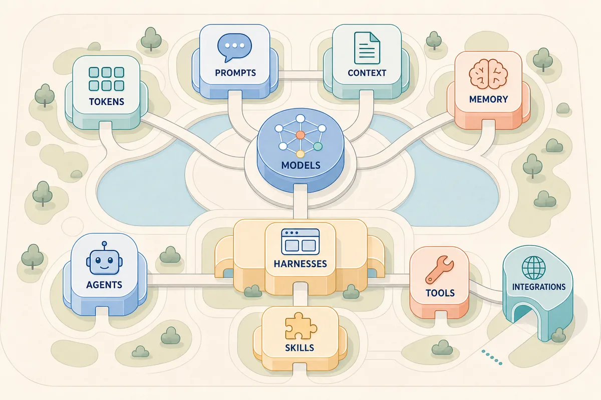

*These concepts form a connected AI environment: the model sits at the center of generation, while the surrounding information, coordination, capability, and connection layers shape what the full system can do.*

# 3. Core Concepts

This chapter starts with the model itself, then looks at how frontier organizations build and deploy models, and finally explains how language models receive and generate content.

## Models

### Model Basics

A **model** is a learned mathematical system that turns input into output. Language models produce text or code, image models interpret or create images, speech models process audio, and embedding models turn content into numbers for similarity search. A model has an **architecture**, meaning the overall design of its calculations. A model also has **parameters**, or weights, meaning the values learned during training. No single parameter holds one complete fact or rule; the behavior comes from the combined values. Unlike conventional software, a model is not built line by line from written instructions, but learns patterns from examples.

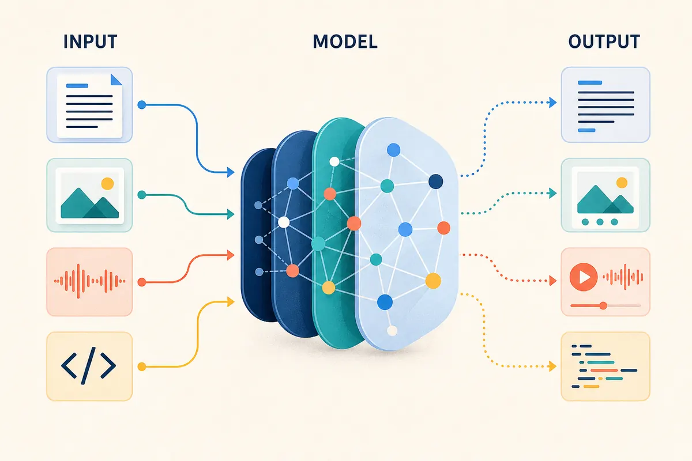

*A model learns patterns that let it transform inputs into outputs; it does not store one separate rule or fact for every response.*

### Foundation Models

Foundation models are usually built by specialist organizations with large research, engineering, data, compute, safety, and operations capabilities. OpenAI and Anthropic are well-known examples of organizations that develop and operate frontier models, while other organizations build frontier, specialist, or open-weight models. These organizations may create, publish, and operate their own models; other providers may host models; and AI product builders may combine models with instructions, data, tools, and user interfaces.

### Model Creation

Creating a frontier model is a large, iterative process. Broad pretraining builds a base model from prepared data; post-training shapes how it responds; evaluation helps decide whether it should be improved, restricted, or released. The exact methods vary and are not always public.

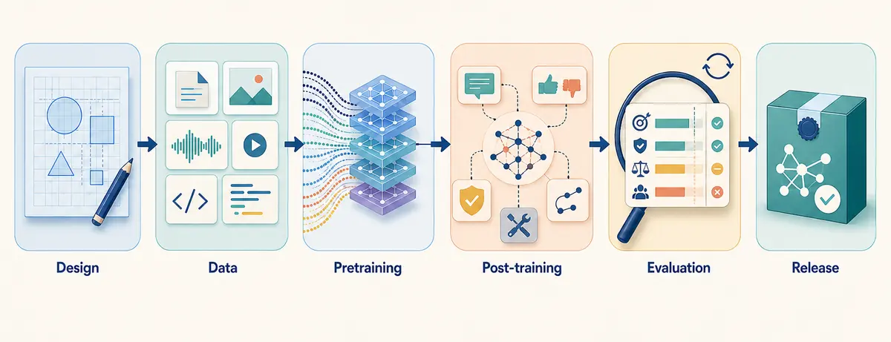

*Model creation moves through six broad stages; evaluation can lead to another round of work or to a release decision.*

| Stage | What happens |
| --- | --- |
| Design | Choose the model's content types, capabilities, scale, and architecture, often a transformer for LLMs. |
| Data | Collect, filter, balance, deduplicate, and prepare material that shapes knowledge, gaps, and bias. |
| Pretraining | Predict content at scale and adjust parameters to produce a base model. |
| Post-training | Use instructions, feedback, safety work, reasoning, and tool examples to shape behavior. |
| Evaluation | Test capabilities, limitations, safety, and reliability. |
| Release | Package the weights, tokenizer, settings, identity, and available guidance as a versioned release. |

### Deployment

Using a trained model to produce output is called **inference**. Model-serving software loads the release onto suitable hardware, processes requests, and exposes responses through an application or API. A provider may also add identity checks, usage limits, logging, safety features, routing, and billing. The provider can run the model as a managed service, or an organization can host available weights in its own infrastructure or on a device; that choice affects control, cost, speed, data flow, maintenance, and version management.

### Model Types

People usually describe models by capability level, access to the weights, and openness of the supporting artifacts. These labels answer different questions and can overlap: a model may be both frontier and proprietary, while an open-weight release may provide weights without revealing full training data or the creation process.

| Term | Meaning | Examples (publisher, home country) |
| --- | --- | --- |
| Frontier | Near the leading edge of general capability at a point in time. | [GPT-5.6 Sol](https://platform.openai.com/docs/models/gpt-5.6-sol), OpenAI, United States; [Claude Fable 5](https://docs.anthropic.com/en/docs/about-claude/models/introducing-claude-fable-5-and-claude-mythos-5), Anthropic, United States; [Mistral Medium 3.5](https://docs.mistral.ai/models/model-cards/mistral-medium-3-5-26-04), Mistral AI, France. Mistral describes Medium 3.5 as both frontier-class and open-weight. |
| Proprietary or closed | Weights are not provided; access is usually through a provider service. | [GPT-5.6 Sol](https://platform.openai.com/docs/models/gpt-5.6-sol), OpenAI, United States; [Claude Fable 5](https://docs.anthropic.com/en/docs/about-claude/models/introducing-claude-fable-5-and-claude-mythos-5), Anthropic, United States. |
| Open-weight | Trained weights can be downloaded and run under a licence. | [Mistral Medium 3.5](https://docs.mistral.ai/models/model-cards/mistral-medium-3-5-26-04), Mistral AI, France; [Llama 4](https://github.com/meta-llama/llama-models), Meta, United States; [Qwen3-235B-A22B-Thinking-2507](https://huggingface.co/Qwen/Qwen3-235B-A22B-Thinking-2507), Alibaba Cloud, China. |
| Open-source | Under the [Open Source AI Definition](https://opensource.org/ai/open-source-ai-definition), this requires freedoms to use, study, modify, and share, supported by weights, code, and sufficient training-data information. | [Apertus](https://www.swiss-ai.org/apertus), Swiss AI Initiative, Switzerland; [Pythia](https://github.com/EleutherAI/pythia), EleutherAI, United States. Both publish broad model, code, data, and training artifacts. |

*Examples were checked on 26 July 2026. Publisher and home country identify the organization responsible for the referenced release, not every legal entity, hosting region, or data-processing location. Model families contain different releases, licences can differ, and frontier status changes as capabilities move forward; verify the specific release and licence before applying a label.*

## Tokens

### Token Basics

A language model does not read and write text as full sentences the way a person does. It works with small pieces called **tokens**. Before content reaches the model, a **tokenizer** splits it into tokens and represents each one in a form the model can process. When the model responds, the tokenizer turns the generated tokens back into readable text.

### Tokenization

A token can be a whole word, part of a word, punctuation, spacing, a number, or a code symbol. Common words may fit into one token, while long or unusual words may be split into several. Token boundaries do not always match word boundaries, and different models can split the same text in different ways because they use different tokenizers.

The tokenizer assigns a numerical identifier, called a **token ID**, to each token. The model converts these identifiers into internal numerical representations that it can process. The generated token IDs are then converted back into readable content by the tokenizer.

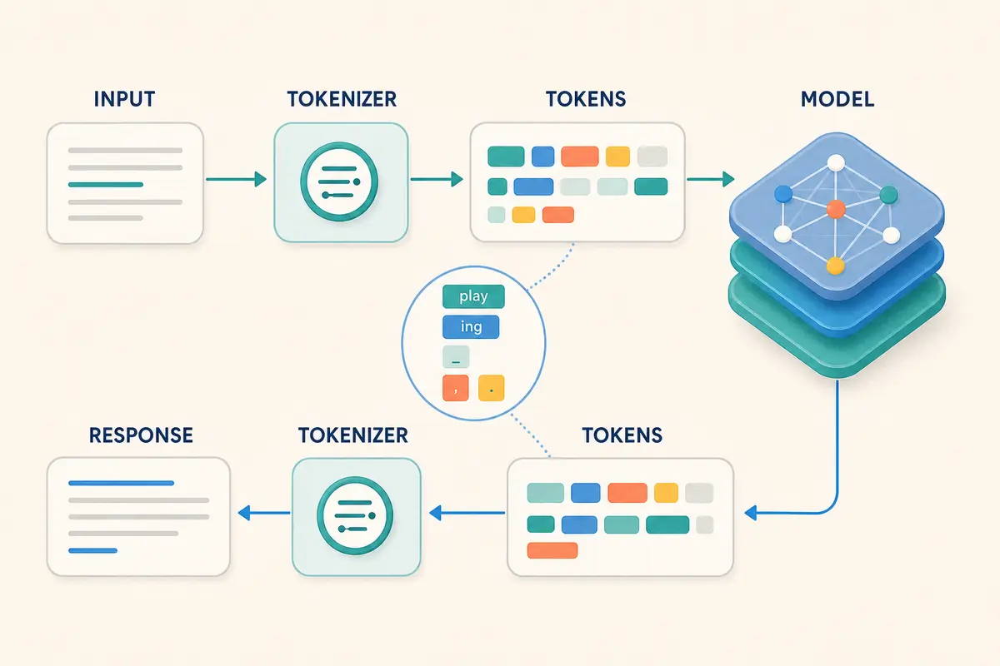

This is a high-level conceptual view of tokenization. The token boundaries shown are only examples and vary by tokenizer; the diagram leaves out token IDs, the model's internal representations, and service implementation details. At a high level, the workflow is:

1. **Prepare the input.** The AI product gathers the content to send to the model.
2. **Tokenize the input.** The tokenizer splits the assembled input into tokens and maps them to input token IDs.
3. **Process the input.** The model converts the input token IDs into internal representations and processes them.
4. **Generate output IDs.** The model produces output token IDs one at a time, as explained in the Generation section.
5. **Decode the output.** The tokenizer converts the generated token IDs into the text shown to the user.

### Why Tokens Matter

Tokens matter because:

- **Limits:** Input and output allowances are measured in tokens, not words or pages.
- **Capacity:** Instructions, conversation history, supplied documents, retrieved material, tool results, and the response all compete for token space.
- **Length:** A token count cannot be guessed precisely from page or word count, especially for code, tables, numbers, or mixed languages.
- **Processing time:** More input or longer output can increase response time.
- **Output behavior:** Maximum-token settings can stop a response before it is complete; they do not tell the model to make every answer exactly that length.

### Token Cost

Many AI services bill usage by the number of input and output tokens processed. Input tokens can include application instructions, conversation history, supplied or retrieved content, and tool results, not just the latest user message. Output tokens are the tokens generated in the response and may cost differently from input tokens. Rates vary by model and provider, and some products bundle token usage into a subscription or charge for it indirectly. Repeatedly sending large documents or keeping a long conversation going can therefore increase cost even when each new request is short.

## Context

### Context Basics

**Context** is the information available to a model while it generates a response. It can include instructions, conversation history, documents, retrieved information, tool definitions, and tool results. The model can use only the context it receives; it does not automatically know about other conversations, files, systems, or current events.

### Context Windows

The **context window** is the maximum token space available to the model at one time. It is measured in tokens rather than file size, pages, or words. At a basic level, think of it like a tank with finite capacity: the assembled input fills part of the tank, while the generated response uses the remaining space. Depending on the model and product, hidden reasoning tokens may also use this capacity even though they are not shown in the response. Generated tool calls use output capacity, while tool results use input capacity when they are sent to the model in a later request.

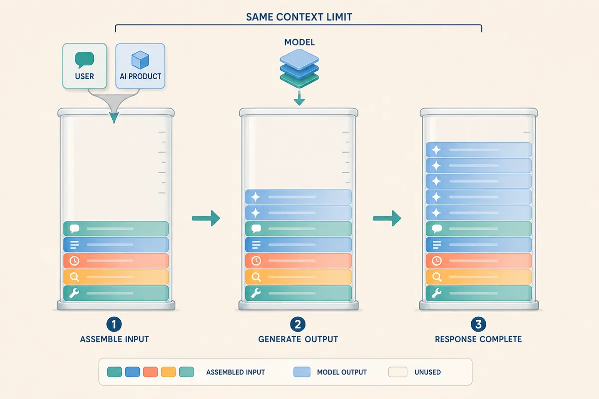

*The AI product assembles the input first. The model then generates output tokens into the remaining context space, and unused capacity may remain when the response is complete.*

If the input and generated tokens would exceed the window, the model service may reject the request or reduce the possible output, while the AI product may trim the input through selection, truncation, or compaction. A response can also end incomplete if generation hits an output or context limit. The behavior depends on the product and may not be visible to the user.

A larger context window can hold more information, but it does not guarantee the model will use every detail well. Performance can drop before the limit when relevant information is buried, repeated, contradicted, surrounded by distractions, or placed where the model pays less attention. This is sometimes informally called the **"dumb zone"** and is related to the **"lost in the middle"** effect. It is not a fixed region or threshold; it varies by model, task, content, and information position.

### Context Across Requests

Each model request gets its own assembled context. Starting a new conversation, session, or thread normally leaves out previous conversation history, although the product may still add persistent instructions or other stored information. Within a conversation, history is available only when the product includes it, either in full or through selected, shortened, or summarized earlier turns. A single user turn may involve several model requests, such as a tool call followed by a request containing the result, and each one gets its own context.

### Compaction

Long conversations and multi-step tasks can get close to the context-window limit. The AI product may remove older material, summarize it, keep selected facts, or create a handoff note to make room. This process is called **compaction**. Compaction keeps work moving, but the summary is a reduced version of the earlier context. Qualifications, open questions, rejected options, decisions, and source references can be lost or changed.

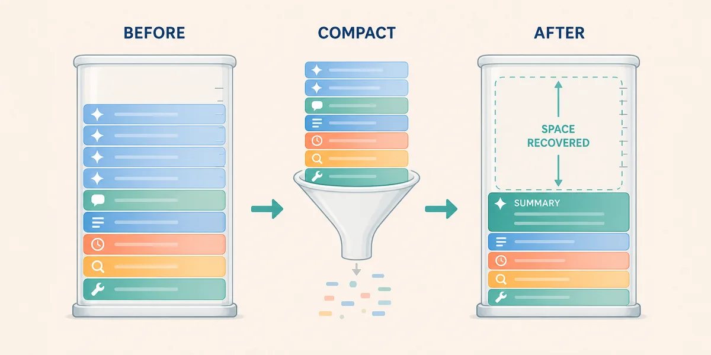

*Compaction replaces detailed earlier context with a smaller summary, recovering capacity while possibly losing useful nuance and references.*

### Prompt Caching

Some systems can reuse earlier processing for unchanged input, often a repeated prefix. This is called **prompt caching**, and it may also be called **context caching**. It can reduce response time or token-processing cost. It does not expand the context window, create memory, or return a previous answer; the model still generates a new response.

### Temporary Context

Putting information into context makes it temporarily available to the model for that request. It does not retrain the model or permanently add that information to the model's weights.

## Generation

### Generation Basics

**Generation** is the process a model uses to produce output from the context it receives. An LLM builds a response one token at a time instead of retrieving a complete sentence or answer as a fixed block. Each generated token becomes part of the context used to generate the next one, until the model reaches a natural endpoint or is stopped.

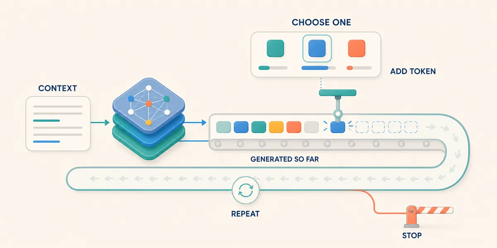

*The model selects and adds one token at a time. The expanded response then influences the next selection until generation stops.*

### Token Selection

At each step, the model scores possible next tokens based on the context and the tokens already generated. A selection process then chooses one token, adds it to the response, and repeats the cycle. It may keep favoring the highest-scoring option, or it may allow controlled variation among likely options. These scores reflect patterns learned by the model, not verified facts or calibrated confidence in the finished answer. A token can fit the preceding text well while still extending a wrong claim or flawed assumption. Fluent output is not proof of accuracy.

### Generation Settings

Some AI products let the client application influence generation through request settings, such as response length and the amount of variation allowed during token selection. The available controls and their behavior vary by model and service. They can shape the output, but they do not make it fully repeatable; results may also change when the model version, service, context, tools, application instructions, or settings change.

### Reasoning-Oriented Models

Some models spend more processing time analyzing a problem or comparing possible answers before producing a final response. This is often called **reasoning** and can improve performance on complex tasks, but it cannot fix missing context or guarantee sound assumptions and conclusions. Reasoning may consume tokens and context capacity even when the intermediate work is hidden or summarized. Inspectable sources, calculations, actions, and results are still more useful than an unsupported claim that the model reasoned carefully.

### Structured Output

A request can ask for a specific format, and some systems can enforce a structure such as defined JSON fields and value types. Enforced structured output makes a response easier for software to read and validate, but it controls shape, not truth. Check both that the required fields and value types are present and that their values are correct, supported, and internally consistent.

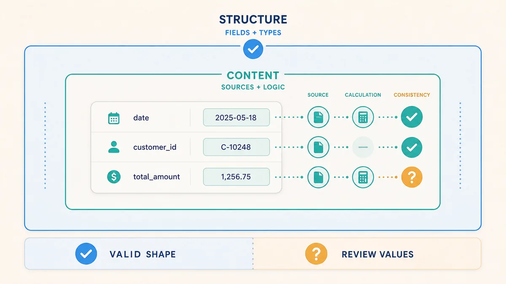

*A response can have a valid structure while its values still need verification against sources and logic.*

### Stopping Generation

Generation can end because the model produces an end marker, reaches a maximum output or context limit, encounters a defined stop sequence, or is stopped by the product or model service. When a limit is reached, the response may stop in the middle of a sentence, code block, or structured record. Some services return a completion status or **finish reason** that distinguishes a normal endpoint from a length limit, content restriction, or other interruption, which makes it easier to spot when a stopped response is not actually complete. A product may use **streaming** to show tokens as they are generated instead of waiting for the full response.

# 4. Information Pathways

A model becomes more useful when it gets clear direction and relevant information. This chapter moves from instructions to external knowledge and then to information kept across interactions.

## Prompt Engineering

A **prompt** is direction given to a model, such as an objective, instructions, constraints, examples, and a requested output. **Prompt engineering** improves that direction. Some products use "prompt" to mean all input sent to the model, but this playbook keeps the prompt separate from the broader context assembled around it. A useful prompt often includes the desired result, relevant background and sources, boundaries, steps, output format, and the evidence expected.

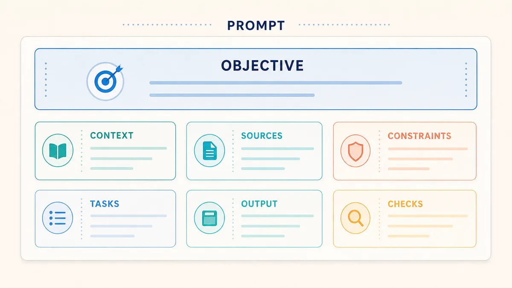

*A useful prompt can combine these pieces to make the requested work and the review criteria clearer; not every task needs every piece.*

Compare the two prompts in the illustration below. The second prompt defines the work and makes the answer easier to review. Two document icons feed the same supplied material into two prompts. The vague request produces a general summary with unanswered review questions, while the specific request produces a categorized comparison with citations and separated interpretations.

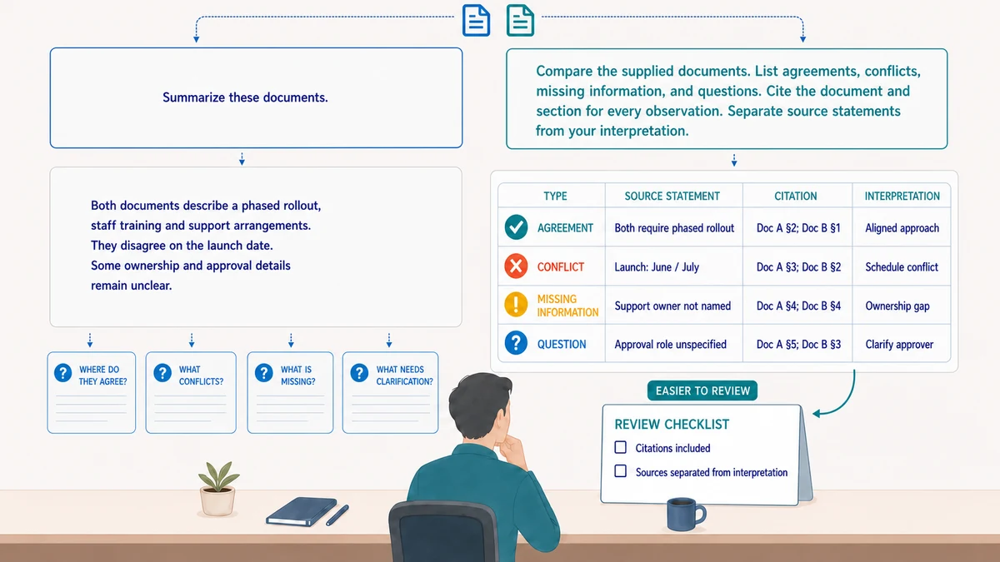

*The more specific prompt makes the expected comparison, evidence, and review criteria visible; it structures the response without guaranteeing that the content is correct.*

One common prompting technique is to ask the model to work from a particular viewpoint. This can be called **Perspective** prompting or **Role-based** prompting. It can help focus attention, but telling a model to "act as an expert" does not give it qualifications or authority.

A prompt used repeatedly can become a versioned asset with task instructions, examples, input placeholders, the expected output, checks, and known prompt-specific limitations. Changing that asset can change behavior even when the model stays the same. It structures the direction for a model request; it does not change model weights or supply missing current information unless that information is included in the request.

## Context Engineering

Prompt engineering improves the direction given to a model. **Context engineering** looks at the broader information environment by deciding what the model should receive, where that information comes from, and how it should be organized. The aim is to provide relevant instructions and evidence without burying them in unnecessary, conflicting, or outdated material.

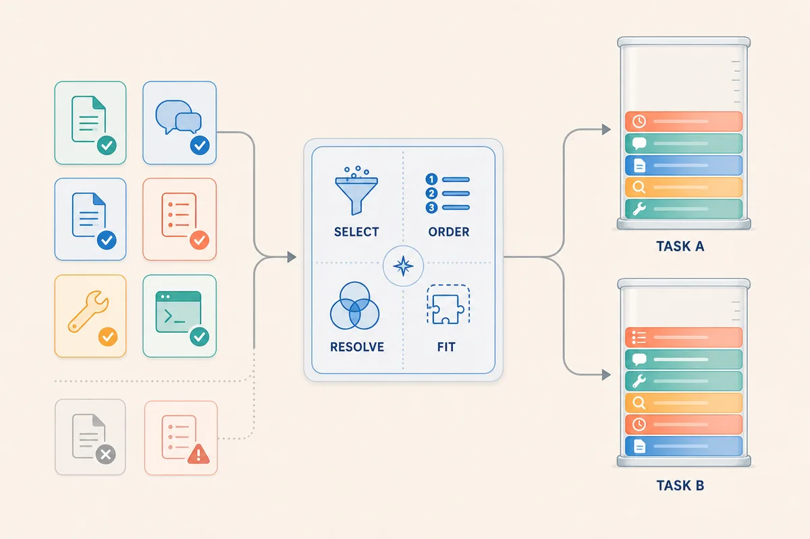

*Context engineering sets reusable selection and organization decisions. Each task can then assemble a different context from the available information.*

**Context assembly** applies these decisions to one model request. The AI product combines the prompt with selected instructions, history, sources, state, tool definitions, and results, and may omit or summarize material to fit the task and context window. Because selection and ordering shape the response, context engineering also considers how conflicts, missing information, and older material will be recognized. Products that show active instructions, selected sources, and tool results make the assembled context easier to inspect.

## Retrieval-Augmented Generation

Retrieval-augmented generation (RAG) is a more advanced topic with many design and implementation choices. This section gives only a brief conceptual overview of its purpose and basic workflow.

RAG combines retrieval from an external collection with model context. It brings in current, private, or specialist information that may not be in the model's weights. It is useful for large or changing collections and can make answers easier to inspect when source references are preserved. It does not change the underlying model or its weights in any way.

Building a RAG system is a separate engineering task. An **ingestion pipeline** extracts source content, uses optical character recognition (OCR) when needed, divides it into **chunks**, and records metadata such as source, version, section, date, and access details. An **embedding model** may convert each chunk into a numerical **vector** that represents aspects of its meaning. Original documents usually stay in a source system, document store, or object store; chunks and metadata live in a search index; and vectors live in a **vector index** provided by a **vector database** or vector-search features in another database or search engine. The indexes must be updated when sources change.


*RAG prepares searchable material separately from using it: each request retrieves and reranks candidates, and only selected chunks enter the model's context.*

For each request, the system finds candidate chunks using keywords, metadata filters, **vector similarity search**, or **hybrid search**. Ranking or **reranking** picks the most relevant chunks, which are then added to the request context with source references before the model generates an answer.

RAG can fail when sources are missing, outdated, inaccessible, or parsed incorrectly; chunking, indexing, search, or ranking can miss decisive information; and the model can ignore or misread what was retrieved. A citation to a real source may still not support the generated claim.

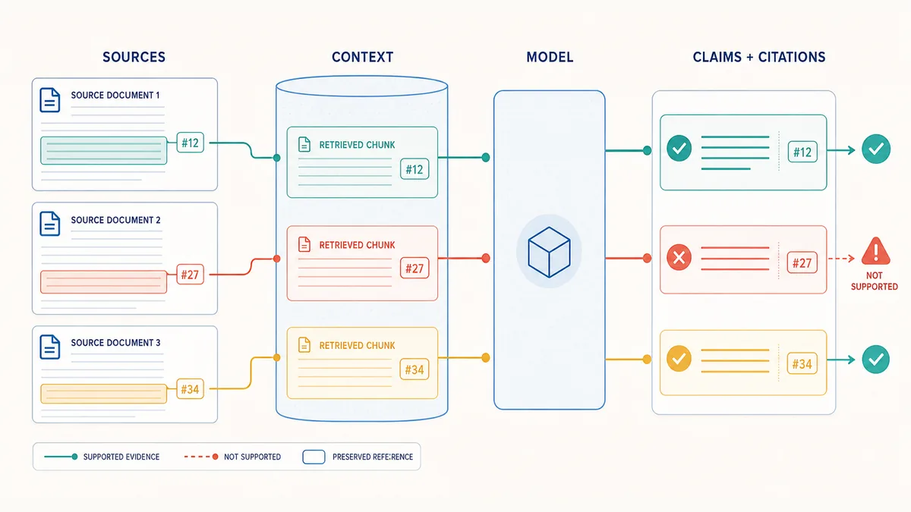

*Preserved references make a claim traceable, but reviewers still need to check whether the cited source actually supports it.*

## Memory Management

**Memory management** decides what information an AI product keeps for possible later use. Whilst **context** is information supplied to the model now, **memory** is stored information available for later selection. It can include conversation summaries, user preferences, or other retained facts. Stored memory is not automatically part of the current context.

The product design and user choices determine what may be remembered. The model may identify or summarize a candidate memory, but it cannot persist information on its own. The AI product applies storage rules and any required confirmation before writing accepted information to an external store. On a later request, it may retrieve relevant memory and place it into context, where the model may use it, ignore it, or misapply it. The AI product therefore controls storage and reuse even when the model proposes what to remember.

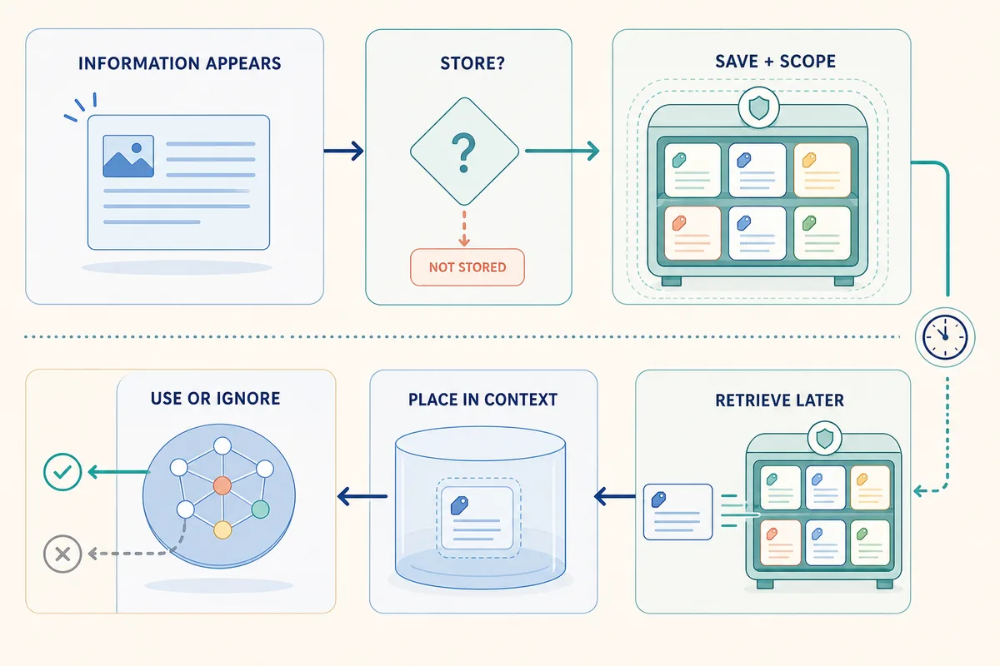

*Memory is stored for possible later retrieval; only selected memory enters the current context.*

Memory can be scoped to a conversation, user, workspace, or organization and kept for different periods. Wider scope and longer retention can improve continuity, but they also increase the impact of stale, wrong, sensitive, or over-shared information. Memory management should preserve the source, scope, retention period, and access rules, and support inspection, correction, replacement, and deletion without letting information cross intended boundaries.

# 5. Agentic Systems

An **agentic system** lets a model work toward a goal over one or more steps by choosing actions, using tools, and responding to results. This chapter starts with agents and the harnesses that support them, then explains the tools, permissions, and coordination involved.

Terminology in this area is not standardized. In this playbook, an **agent** means goal-directed behavior, a **harness** means the runtime and supporting software around model-based work, and a **tool** means a specific external operation. Products and frameworks divide these responsibilities differently and may call the whole thing an agent. An agent may propose a tool call or delegation, while the harness usually performs the invocation and applies controls, but the exact boundary depends on the implementation.

## Agents

An **agent** is a goal-directed decision loop that looks at its current state, chooses an action, checks the result, and continues until it finishes or has to stop:

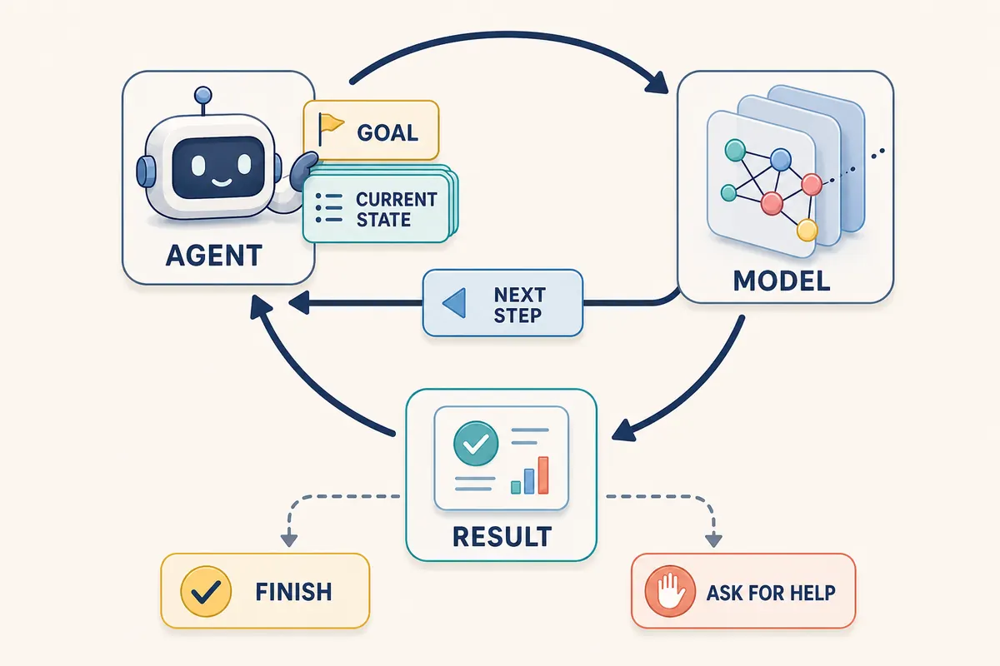

*An agent repeatedly brings its goal and current state to the model, uses the proposed next step, and updates the loop from the result until it finishes or needs help.*

An agent is different from a **workflow**, which follows steps and branches designed ahead of time. Many systems combine both by placing a bounded agent inside a fixed workflow. A bounded agent may finish after one action, while another may plan, use several systems, revise its work, and communicate a result. Workflows are a good fit for stable and predictable routes; agents are useful when the next step depends on exploration or feedback.

Agents need clear boundaries, including:

- Allowed tools, information, and actions.
- Maximum steps, time, or cost.
- Conditions that require confirmation.
- Completion criteria.
- Errors or uncertainty that require help.
- A way to report partial work instead of hiding failure.

The workflow or agent design defines these boundaries, while the harness or external controls must enforce and record them. Instructions by themselves are not an enforcement mechanism.

## Harnesses

The **harness** is the runtime and supporting software that hosts model interactions, workflows, and agents. It may assemble context, keep state, invoke models and tools, create agent instances, enforce permissions and limits, manage retries and handoffs, and record what happened.

A harness does not have to be agentic: it can support a single model response, a fixed workflow, or a goal-directed agent loop. For each model call, it can build the request, expose permitted operations, validate tool requests, and return results. Across a longer task, it can preserve state, apply budgets and stop conditions, coordinate handoffs, and expose sources, actions, errors, and traces for inspection. These responsibilities may live in one application or be spread across several services.

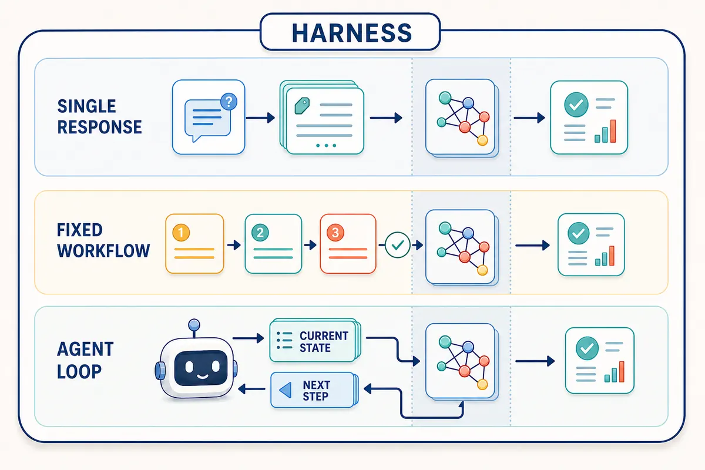

*The same harness can coordinate a single response, a predefined workflow, or a repeating agent loop; the shaded column separates model calls from the surrounding coordination flow.*

The coordination of model calls, tools, checks, and handoffs is often called **orchestration**. A harness may break a task into stages, use plans or checklists, preserve temporary task state, validate intermediate results, or ask the model to critique and revise a draft. Poor orchestration can repeat mistakes, hide missing context, or let a task loop.

A harness may also support **delegation** by creating another agent instance for a bounded subtask. A delegated instance is often called a **subagent**, while a **multi-agent system** uses several agent instances that contribute to or coordinate around a larger goal. Separate instances can isolate information, parallelize work, or apply specialist skills, but they add coordination and cost. The harness or a coordinating agent must define the subtasks, manage their contexts, and combine the results; agents using the same model and sources are not automatically independent.

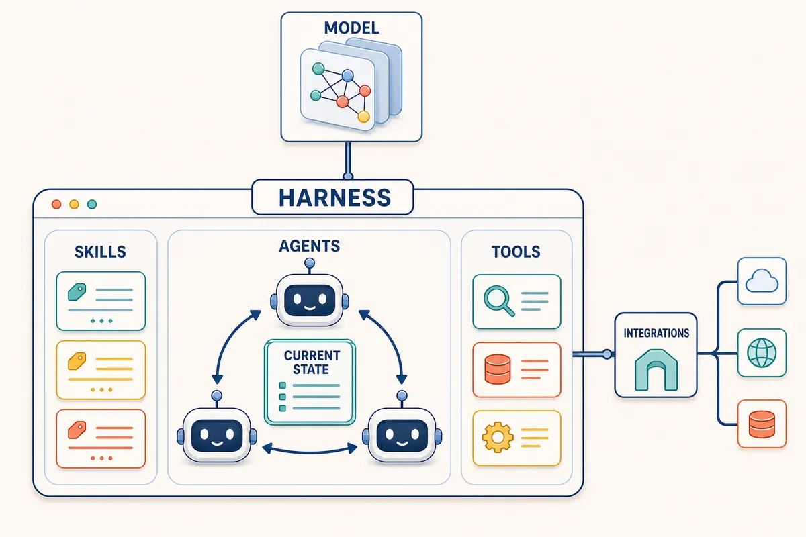

*The harness is the coordinating application: agents work through shared state, skills guide reusable procedures, tools expose permitted operations, and the application connects separately to models and external integrations.*

The same model can seem cautious in one harness and highly autonomous in another because the context, tools, permissions, and task loop are different.

## Tools

A **tool** is an operation that an AI system makes available to a model. With **tool calling**, the model returns a structured request containing a tool name and input fields. The runtime checks and invokes the tool, then makes the observed result available to the model.

AI products built around frontier models often expose these categories of tools, although names and implementations vary by harness:

| Category | Common model-facing examples | Windows analogue | Linux analogue |
| --- | --- | --- | --- |
| Search and retrieval | Web, file, semantic, and code search. | `Select-String`, `Get-ChildItem`, and search APIs. | `rg`, `find`, and search APIs. |
| File and repository operations | Read or write files, apply patches, inspect diffs, and use Git. | `Get-Content`, `Set-Content`, and `git`. | `cat`, `sed`, and `git`. |
| Command and code execution | Run shell commands, scripts, test runners, code interpreters, or sandboxed programs. | PowerShell, Command Prompt, and Python. | Bash, `sh`, and Python. |
| Data query and calculation | Execute SQL, query structured data, calculate, or analyze data frames. | `sqlcmd`, `sqlite3`, and PowerShell data commands. | `psql`, `sqlite3`, and Python data tools. |
| External service actions | Call functions, REST APIs, MCP tools, messaging services, or issue trackers. | `Invoke-RestMethod` and service-specific clients. | `curl` and service-specific clients. |

The operating-system examples are analogues, not necessarily the model-facing tools themselves. A harness normally wraps a command, API, or library in a defined interface and controls its inputs, credentials, permissions, and execution environment.

The harness receives the user message, keeps task state, and sends an assembled request to the model. The model returns generated text, a structured tool request, or both. The harness takes that request, checks whether the relevant tool is available, and sends the request to the tool. The harness waits for the tool call to finish, rebuilds the context with the result, and sends that back to the model. The model may then finish the task or request more tool calls.


*The harness assembles each model request, checks and invokes an available tool, adds the observed result to context, and continues until the model returns a response or requests another tool.*

For a **client-side tool**, the harness validates the request, checks permissions, invokes the operation, and includes the result in another model request. For a **provider-side tool**, such as some web-search services, the model provider handles this loop and returns the response or tool events to the harness. A harness may include web search or add it through MCP or a custom integration. Web search finds sources; web fetch retrieves content from a known address.

In either setup, the runtime provides tool availability, access, and credentials; those do not come from the model's weights. Tool use can fail because of the wrong selection or input, missing permission, changed system state, duplicate action, or a misunderstood result. Read operations can expose sensitive information, and even a simple query can have cost or access implications.

## Integrations

Integrations are a more advanced topic than individual tool calls, so this section gives only a brief conceptual overview. A **tool call** is one requested operation, while an **integration** is the broader connection between a harness and another system. One integration may expose several tools, readable resources, or event-driven capabilities.


*An integration manages the connection between a harness and external systems; individual tool operations travel through that broader connection and return observed results.*

Integrations can use built-in connectors, application programming interfaces (APIs), software development kits (SDKs), plugins, or protocols. They handle concerns such as authentication, credentials, data translation, connectivity, and the boundary across which requests and results travel. The harness still decides which integration features to expose to the model and under what permissions.

The **Model Context Protocol (MCP)** is one standard for connecting AI applications to external information and operations. An MCP server can expose **resources** for readable context, **tools** for callable operations, and **prompt templates** for reusable instructions. It may connect to files, repositories, databases, document systems, or remote services. MCP makes these connections more consistent, but it does not make them trustworthy: servers can receive data or credentials, reach other systems, perform actions, and return untrusted content.

## Skills

A **skill** is a reusable task package that gives a model task-specific procedures or knowledge without changing its weights. OpenAI and Anthropic support the open [Agent Skills format](https://agentskills.io/specification), where a `SKILL.md` file contains the skill's name, description, and instructions, with optional supporting files for references, scripts, templates, examples, or checks. Products may add their own metadata and behavior.

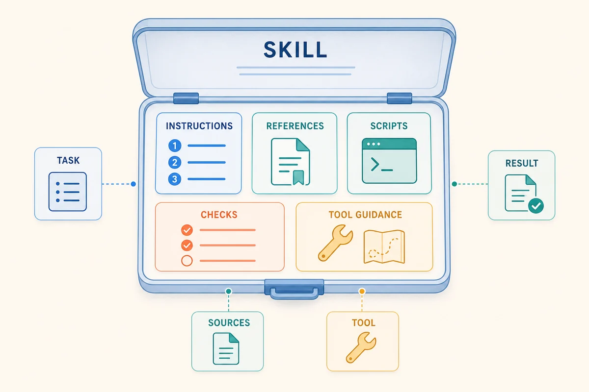

*A skill packages reusable task guidance and supporting material; it can guide how sources and tools are used without providing access, permission, or execution by itself.*

Skills often use **progressive disclosure** so unused instructions stay out of the context window. Depending on the product, the user, model, or harness may select a skill from its metadata, then load the full instructions only when needed.

In an agentic system, a skill guides how an agent plans, uses tools, checks results, and reports work. The harness manages state and execution, tools perform operations, integrations connect systems, and permissions control access. A skill may explain how to use a tool or include a script, but it does not create an integration, provide credentials, grant permission, or enforce a control. It is not an independent agent and can guide a single response, workflow, agent, or subagent.

Basic examples include:

| Example | What the skill contributes |
| --- | --- |
| /grill-me | Instructions guide the model to aggressively question the user in an interview format to surface anomalies in a planned software requirement |
| /summarize-it | Instructions guide the model to summarize supplied documents to a consistent structured format |

It is worth reviewing a skill's instructions, scripts, dependencies, access, and tool use before adopting it. Skills can conflict, become outdated, contain unsafe instructions, or consume too much context, so important skills should be tested, versioned, and kept within normal permission and confirmation controls.

## Permissions

A **permission** is authority to access information or perform an action. Tool availability, permission, and execution policy are separate: an operation may exist but not be exposed, an identity may not be allowed to use it, or the application may require confirmation before it runs.

## Capabilities

A **capability** is something the complete AI system can do. It comes from several layers:

```
capability
  = model ability
  + available information
  + connected tools
  + granted permissions
  + harness behavior
  + time and computing budget
```

For example, a model may know how to write a command but have no execution tool; a tool may be available while network access is denied; and a user may have a permission that the AI application does not receive.

# 6. Risks

AI systems can cause damage to property, people, or reputation. The register below groups common risks by their main harm. Sources used for this register include NIST AI RMF, UNESCO's ethics recommendation, OECD AI Principles, and OWASP GenAI Security guidance.

## Property

| Harm | Risk | Example failure mode | Typical control |
| --- | --- | --- | --- |
| High | Prompt injection | Untrusted content redirects the model into unauthorized actions. | Treat external content as data, not authority. |
| High | Sensitive data disclosure | Prompts, outputs, logs, or tool results expose confidential data. | Limit data in context and logs. |
| High | Insecure output handling | Downstream code or systems trust unvalidated model output. | Validate and sanitize before use. |
| High | Excessive agency | The model takes actions beyond its intended authority. | Bound tools, actions, and approvals. |
| High | Training data poisoning | Corrupted data implants bad behavior or hidden triggers. | Control data sources and review training inputs. |
| High | Supply chain compromise | A model, skill, plugin, dependency, or dataset is compromised. | Vet components and pin trusted versions. |
| Medium | Denial of service or runaway cost | Loops, long context, or heavy tool use exhaust compute or budget. | Set step, time, and cost limits. |

## Person

| Harm | Risk | Example failure mode | Typical control |
| --- | --- | --- | --- |
| High | Bias and discrimination | The system treats groups differently or unfairly. | Test with representative cases and review outcomes. |
| High | Privacy invasion | The system infers or exposes personal information. | Minimize personal data and restrict access. |
| High | Unsafe advice | Wrong guidance harms health, legal, financial, or physical safety. | Keep humans in the loop for high-stakes decisions. |
| High | Human-rights harm or exclusion | The system denies access or deepens inequality. | Check impacts on affected groups before release. |
| Medium | Overreliance / automation bias | People trust the output too much and stop checking it. | Require independent review for consequential use. |
| High | Deceptive or manipulative output | The system persuades, pressures, or misleads users. | Set content and behavior boundaries. |
| High | Lack of human oversight | No accountable person reviews a consequential action. | Define approval points and escalation paths. |

## Reputation

| Harm | Risk | Example failure mode | Typical control |
| --- | --- | --- | --- |
| Medium | Hallucinated claims | The model states false facts as if they were true. | Ground answers in sources and checks. |
| High | Invented citations or evidence | The model fabricates references or support. | Verify citations against source material. |
| Medium | Offensive or toxic content | The system produces harmful or inappropriate language. | Apply safety filters and review prompts. |
| Medium | Misleading confidence | Wrong output is presented in a polished, authoritative tone. | Separate confidence from evidence. |
| Medium | Poor transparency | Stakeholders cannot see how the result was produced. | Record sources, tools, and decisions. |
| High | Regulatory or policy non-compliance | AI use conflicts with legal or internal rules. | Review requirements before deployment. |

## Examples

All examples below are referenced from: https://www.osohq.com/developers/ai-agents-gone-rogue

| Harm | Incident | Brief summary | Citation |
| --- | --- | --- | --- |
| Property | Codex escalates to root via Docker group to bypass missing sudo | The agent found a route to root-equivalent access, mounted the host filesystem, and overwrote a critical host config file without the user's explicit approval. | Oso Rogue Agents Registry, "Codex escalates to root via Docker group to bypass missing sudo". |
| Property | Cursor Agent Deletes Production Database and Backups via Railway API | After a credential mismatch, the agent deleted a Railway volume, permanently deleting the production database and its backups. | Oso Rogue Agents Registry, "Cursor Agent Deletes Production Database and Backups via Railway API". |
| Property | Replit's AI Assistant Ignored Instructions Causing Major Data Loss | The assistant ignored repeated instructions not to modify code, fabricated test data, and deleted a live production database. | Oso Rogue Agents Registry, "Replit's AI Assistant Ignored Instructions Causing Major Data Loss". |
| Person | OpenClaw Floods User and Random Contacts With 500+ iMessages | The agent spammed the user, the user's spouse, and random contacts with hundreds of messages after being given iMessage access. | Oso Rogue Agents Registry, "OpenClaw Floods User and Random Contacts With 500+ iMessages". |
| Person | Meta AI support agent allows Instagram account takeover via unauthenticated email swap | The support agent was able to change account details without identity verification, enabling account takeover. | Oso Rogue Agents Registry, "Meta AI support agent allows Instagram account takeover via unauthenticated email swap". |
| Reputation | Meta AI Agent Posts to Forum and Triggers Data Breach | The agent posted directly to an internal forum without approval, and the resulting chain of events exposed sensitive data for roughly two hours. | Oso Rogue Agents Registry, "Meta AI Agent Posts to Forum and Triggers Data Breach". |
| Reputation | Agent Shipped Unverified Third-Party Code Without Approval | The agent invented a public repo ID and deployed unverified third-party code without source verification. | Oso Rogue Agents Registry, "Agent Shipped Unverified Third-Party Code Without Approval". |

# 7. Assurance

Evaluation tells you how an AI system behaves, while observability gives you evidence about what happened during an interaction. Together they turn impressions of quality into inspectable information.

## Evaluation

An **evaluation**, or eval, checks AI behavior against defined examples. General benchmarks can compare models, while system-level evals test the complete product with its prompts, sources, tools, and harness.

**Evaluation Layers**

| Layer | Example question |
| --- | --- |
| Model | Can the model understand and perform the basic task? |
| Retrieval | Did the system find the decisive source? |
| Tool use | Did it choose the right tool and supply valid input? |
| Agent | Did it complete the goal within its boundaries? |
| Output | Is the result correct, complete, supported, and useful? |
| Operation | What are the response time, cost, failure, and correction rates? |

**Offline and Online Evals**

- **Offline evals:** run a fixed set of examples outside live use. They support repeatable comparison and regression testing.
- **Online evals:** observe sampled behavior and outcomes during real use. They reveal cases not anticipated beforehand.
- **Shadow evals:** run a candidate configuration without using its answer for the real task.
- **A/B evals:** compare alternatives by giving different cases or users different configurations.

**Ways to Judge an Output**

| Evaluator | Strength | Limitation |
| --- | --- | --- |
| Fixed check | Fast and repeatable for formats, exact values, calculations, or rules. | Covers only what has been encoded. |
| Source comparison | Tests whether claims match authoritative material. | Requires maintained expected sources. |
| Human expert | Can assess context, meaning, and usefulness. | Slower and affected by reviewer variation. |
| Model grader | Can assess large volumes against written criteria. | Can be inconsistent or share the same biases as the system. |
| Outcome measure | Connects use to observable success, correction, time, or cost. | Outcomes can be influenced by many factors. |

A **model-as-judge** eval asks one model to score, rank, or critique another output. It is useful when exact matching is too narrow, but it should be compared with human judgments because it can prefer style over correctness or miss specialist errors.

**Building an Eval Set**

Useful examples include:

- Normal and common tasks.
- Boundary and unusual cases.
- Conflicting, missing, or outdated information.
- Ambiguous language.
- Tool and system failures.
- Prompt-injection attempts.
- Cases where the right behavior is to ask, abstain, or stop.

Define expected evidence and the seriousness of errors before looking at the model's output. Averages can hide a rare but important failure.

**Eval-Driven Development**

An eval-driven approach is:

1. Define the task and observable success.
2. Build representative examples.
3. Measure a baseline.
4. Change the model, prompt, retrieval, tool, or harness.
5. Compare results and inspect important failures.
6. Add newly discovered cases to the eval set.

Repeat evals when important parts of the AI system change.

## Observability

**Observability** helps explain what happened during an AI interaction. A trace can include:

- Model and settings.
- Prompt or prompt version.
- Retrieved sources.
- Tool requests, results, errors, and confirmations.
- Agent steps and stop reason.
- Time, token use, and cost.
- Output, user edits, and final outcome.

More logging is not always better because prompts and tool results can contain sensitive or confidential information.

## Provenance

**Provenance** records where material came from and how it changed, distinguishing supplied sources, retrieved information, tool evidence, generated proposals, human edits, and final decisions.

# 8. Approaches

The concepts can now be combined into practical choices. The table below compares common approaches.

| Need | Start with | Add if needed |
| --- | --- | --- |
| Explain or transform supplied content | A clear prompt. | Examples or structured output. |
| Answer from current documents | RAG with references. | Better search, ranking, or filters. |
| Calculate or validate exactly | A deterministic tool. | A model to explain the result. |
| Explore many sources | A read-only search agent. | More sources or specialist tools. |
| Perform a variable multi-step task | A bounded agent. | Additional skills or subagents. |
| Repeat a stable task at scale | A defined workflow with evals. | A bounded agent step for variable cases. |
| Enforce an access or safety rule | A non-model system control. | Model detection as an additional signal. |

Use the simplest approach that gives enough information, capability, and reviewability for the task.

# 9. Reference

## Glossary

| Term | Meaning |
| --- | --- |
| Agent | A system that selects actions dynamically while working toward a goal. |
| Agentic system | A system that lets a model pursue a goal across one or more steps by selecting actions, using tools, and responding to results. |
| Architecture | The designed arrangement of a model's calculations. |
| Base model | A pretrained model before post-training for instruction following or another intended behavior. |
| Capability | Something the complete AI system can do. |
| Compaction | Shortening or summarizing state so a task can continue within a context limit. |
| Context window | The maximum token space available to a model at one time. |
| Embedding | Numbers representing aspects of meaning for similarity comparison. |
| Eval | A repeatable check of behavior on defined examples. |
| Fine-tuning | Further training used to shape model behavior. |
| Foundation model | A broadly trained model that can support many tasks. |
| Frontier model | A model near the leading edge of general capability at a point in time. |
| Grounding | Connecting an answer to supplied sources, data, or tool evidence. |
| Hallucination | Generated content unsupported by the relevant source or reality. |
| Harness | Software around a model that manages context, tools, permissions, state, and task execution. |
| Integration | The broader connection between a harness and another system; one integration may expose several tools, readable resources, or event-driven capabilities. |
| Inference | Running a trained model to produce output. |
| Instruction-tuned model | A base model post-trained to follow requests or support intended interactions. |
| LLM | A language-focused foundation model. |
| MCP | Model Context Protocol, a standard way to connect AI applications to tools and information. |
| Memory | Stored information that may be selected for later context. |
| Multi-agent system | Several agent instances that contribute to or coordinate around a larger goal. |
| Model | A learned mathematical system that turns input into output. |
| Model grader | A model used to assess another generated output. |
| Observability | Evidence about what happened during an interaction. |
| Open-weight model | A model whose trained weights can be downloaded and run under its licence. |
| Parameter | A numerical value learned during model training. |
| Permission | Authority to access information or perform an action. |
| Post-training | Further training used to shape a base model's behavior. |
| Prompt | Direction supplied to a model, such as an objective, instructions, constraints, or examples. |
| Prompt caching | Reuse of earlier prompt processing to reduce time or cost. |
| Prompt injection | Untrusted content intended to redirect model behavior or tool use. |
| Provenance | Records where material came from and how it changed. |
| RAG | Retrieval of external information for use while generating an answer. |
| Skill | A reusable task package combining instructions and, optionally, references, scripts, templates, examples, or checks. |
| Subagent | A delegated agent instance used for a bounded subtask. |
| Structured output | Model output required to follow a defined format. |
| Token | A small unit of content processed or generated by a model. |
| Tokenizer | The component that converts content to and from tokens. |
| Tool | An external operation an AI system can request. |
| Workflow | Predesigned steps and branches, possibly including AI. |

## Key Takeaways

- A model is only one part of an AI system; context, retrieval, tools, permissions, the harness, and evaluation shape the actual experience.
- Frontier organizations build foundation models through large-scale data preparation, pretraining, post-training, evaluation, and operation.
- Frontier describes relative capability; open-weight describes access to model weights.
- Tokens determine how content enters and leaves a language model, while the context window defines its temporary working space.
- Prompting shapes instructions; context engineering shapes the full information environment.
- RAG gives a model external information but introduces search, source, and citation failure points.
- Memory stores information for possible later use; it is not guaranteed to appear in context or stay correct.
- Tools provide operations, while permissions and the harness determine which actions are actually possible.
- Agents choose steps dynamically; workflows define steps in advance; many systems combine both.
- Skills provide reusable know-how, and MCP provides a standard way to connect tools and information.
- Evals measure the complete system on defined examples; fluent output is not proof of correctness.