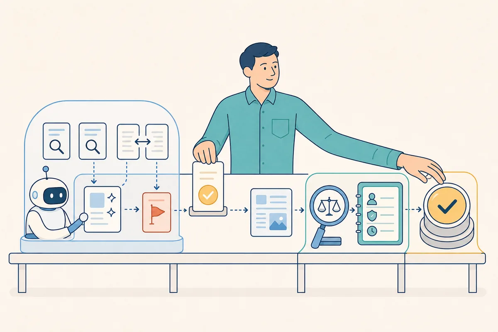
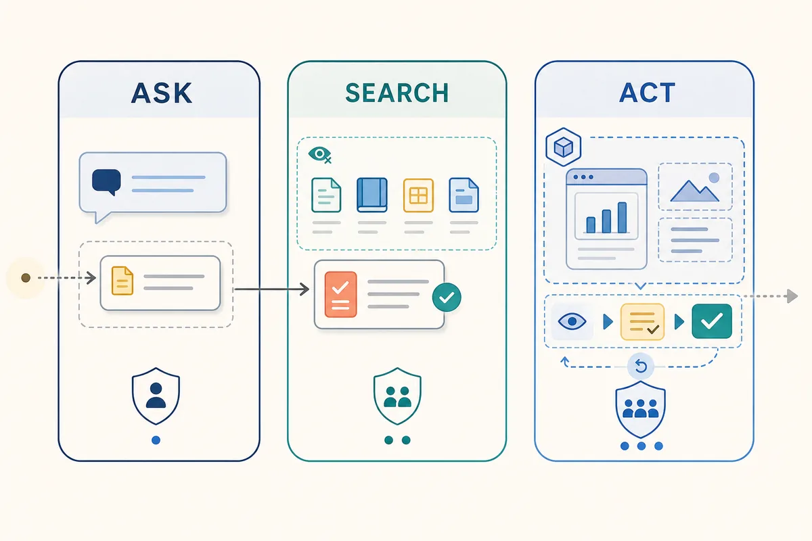
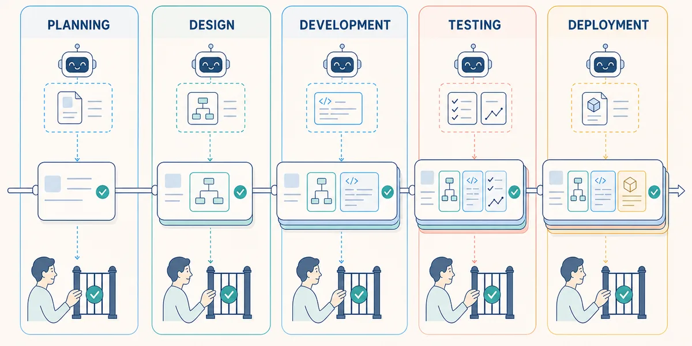

PLAYBOOK 01: AI IN THE SDLC

# 1. Purpose

This playbook helps teams to begin to apply AI concepts across the software development life cycle (SDLC). The aim is to help them start small, choose a sensible way to work, and build checking into the task from the beginning.

# 2. Introduction

These playbooks treat AI as an assistive technology within human-led work. AI can help explore, compare, draft, and find gaps, while people bring context, judgement, accountability, and authority over decisions.

*AI can assist with parts of the task, while people provide context, apply judgement, remain accountable, and make decisions.*

Within the SDLC, AI can help teams understand problems, explore sources, draft changes, find gaps, and prepare work for review. It works best on bounded tasks with clear sources, actions, outputs, and checks, but it can also miss details or be wrong. Teams remain responsible for the data they provide, permissions they grant, AI actions they authorise, and outputs and decisions they accept. The table below gives examples for each SDLC stage.

| SDLC stage | AI can help teams |
| --- | --- |
| Planning | Explore the concept, build its context, challenge assumptions and risks, and prepare a high-level URS. |
| Design | Translate the approved URS into software requirements and acceptance criteria, explore solution options, and define architecture and interfaces. |
| Development | Explore and explain code, draft or review changes, and update documentation. |
| Testing | Derive scenarios, suggest data or automation, find boundaries, map coverage, and analyse failures. |
| Deployment | Summarise changes, draft runbooks, compare configuration, and suggest release, smoke, or rollback checks. |

# 3. Approach

One approach is to start with the task rather than the tool by describing the outcome, useful sources, excluded information, necessary access, expected output, and how it could be checked. The simplest mode with the least access is often enough. For example, **"Help with requirements"** could become:

> Compare these three approved source documents. Identify requirements, timing constraints, conflicts, and gaps relevant to a sponsor's request to record medication administered to a trial participant between pre-treatment and post-treatment efficacy assessments. Treat medication administration and efficacy analysis as outside the application. Give exact references and draft clarification questions. Do not create final requirements.

Ask, Search, and Act are playbook labels for thinking about increasing capability and access, not industry-standard or mutually exclusive product categories. Ask works with supplied context, Search adds approved read-only sources, and Act adds changes or repeated actions. A product or task may combine these modes. Choose the simplest combination that can complete the task while keeping it understandable and reviewable.

*Ask, Search, and Act add progressively more capability and access.*

| Mode | Useful for | Worth checking |
| --- | --- | --- |
| Ask | One-off explanation, comparison, critique, and drafting with chat or embedded assistants. | Whether the product also includes the current file, workspace, history, or hidden instructions. |
| Search | Work across several approved sources with retrieval or read-only agents. | What was searched, found, missed, or inaccessible, and whether each citation supports its claim. |
| Act | Changes or repeated actions with editing agents or automated workflows. | Whether an isolated branch or sandbox, previews, confirmation, and recovery are available. |

The product around the model determines the context, credentials, permissions, tools, and evidence available. Before using a product, confirm where data is processed and retained, which data classifications are approved, whether supplied information may be used for training or service improvement, and whether actions and evidence are visible, attributable, confirmable, and reversible as the task requires.

It is important to be aware that Search and Act modes can expose an AI system to instructions embedded in documents, websites, repositories, tickets, or logs. Treat retrieved content as potentially untrusted data rather than authority to change the task, disclose information, or use additional tools. Product controls should keep source content from overriding approved instructions, permissions, and confirmation requirements.

# 4. Loop

A loop is a repeatable way of working in which people prepare an AI task, check the result, and either accept it or use what they learned to try again. In this loop, the team defines the work, provides context, sets access, requests evidence, and reviews the output before deciding what happens next. The details may change across the SDLC, but the cycle remains useful whenever an AI result benefits from review and refinement.

*People set the boundaries, inspect the output, and accept it through the normal process or revise and repeat.*

A loop can be any repeatable process that feeds results or review into the next attempt; it does not need one fixed design. The guideline suggested here uses six stages: Define, Provide Context, Set Access, Request Evidence, Check, and Accept or Revise. Teams can adapt, combine, or repeat these stages to suit the task and their existing process.

## 1. Define

One observable outcome can anchor the task, together with its sources, boundaries, expected output, stopping point, and method of checking. This focus helps the AI prioritise relevant work and makes a useful result easier to recognise. It also reduces the chance of a broad request producing a polished but incomplete answer.

## 2. Provide Context

A small set of approved information may be enough. Useful context can include relevant users, workflow, terminology, constraints, and decisions. This gives the AI details it could not otherwise know and helps it produce work that fits the situation, while irrelevant or conflicting material can hide what matters.

## 3. Set Access

Read-only access is often a suitable starting point, with editing, execution, network, or external-system access added when needed. Matching access to the task allows the AI to do useful work without introducing unnecessary actions or complexity. A prompt cannot reliably prevent actions the system permits. For example, asking an agent not to edit files does not enforce read-only access if its tools still allow changes.

## 4. Request Evidence

Inspectable output can make review easier by identifying sources, assumptions, searches, gaps, open questions, and failed checks. An AI's account cannot be trusted as evidence on its own: a cited source may not support the claim, and a reported action may not have succeeded. The account can still guide the review, while opened sources and independently run checks provide stronger support. Keeping these details visible helps teams find problems, make corrections, and improve the next attempt without relying on hidden chain-of-thought.

## 5. Check

Checking might involve opening cited sources, inspecting affected artifacts, comparing calculations, running repository-native checks, or observing the real system. Agreement from a person or another AI does not verify an answer; confidence comes from checking it against an authoritative source, calculation, test result, or observed behaviour.

## 6. Accept or Revise

AI output can remain a proposal until the usual checks and approvals are complete. Useful work can move forward, while weak tasks, context, or boundaries can be revised and tried again before adding access. Records of sources, contributions, checks, decisions, task briefs, source versions, and available product details can make the work easier to explain or revisit, although another run may differ.

Together, these stages help a team get useful AI output without treating the first response as finished work. A brief look back at effort, coverage, corrections, and review can help the team decide whether the approach is worth using again. The next section shows how the loop might support one change from planning through deployment.

# 5. Example

A team is extending a diagnostic application that performs different types of clinical tests. For use in a clinical trial, the sponsor wants authorised clinicians to record details of medication administered to a trial participant between pre-treatment and post-treatment assessments so that drug efficacy can be analysed later outside the application. The application records the medication details and timing; it neither administers medication nor analyses efficacy.

The change may affect requirements, clinical workflow, data models, interfaces, tests, documentation, and release activities. The team has approved, de-identified research notes, current requirements, a terminology guide, and the relevant repository. At each SDLC stage, it applies the loop with a suitable AI approach while people review the output and make the decisions.

*The change bundle grows across the SDLC as AI prepares proposals and people decide what moves forward.*

## Planning

The team explores the sponsor's need, what clinicians must record about the administered medication, and which protocol-defined timing rules apply. AI helps frame the concept, assemble source-linked context, and challenge assumptions about authorised users, trial participants, timing, data integrity, privacy, safety, and the relationship between the medication record and assessment results. The scope explicitly excludes administering medication and determining efficacy. Product and clinical reviewers resolve enough uncertainty to approve the context and a high-level requirement: `URS-MED-014`: *"The application shall enable authorised clinicians to record medication administered to a trial participant between the pre-treatment and post-treatment efficacy assessments."*

## Design

With `URS-MED-014` approved, an agent helps translate the need into a candidate software requirement: `SRS-MED-CAPTURE-014`: *"The application shall record the medication name, dose, route, administration date and time, and trial participant identifier; associate the record with the relevant pre-treatment and post-treatment efficacy assessments; and apply the approved timing rules."* It compares workflow, data-model, interface, validation, timing, and access-control options and identifies affected components, data flows, and trade-offs. The design does not add medication-administration or efficacy-analysis functions. Reviewers agree the SRS, acceptance criteria, architecture, and interface decisions or return unclear needs to Planning.

## Development

Using the approved software requirement and design, a read-only agent identifies the code, tests, and documentation that may be affected. It lists the files and symbols it inspected and records gaps or inaccessible areas. After an engineer checks the impact map, an editing agent prepares a candidate change in an isolated branch. Engineers review the diff, inspect security and error handling, run repository checks, and confirm that the implementation follows the requirement and design.

## Testing

Using `SRS-MED-CAPTURE-014`, its acceptance criteria, and the candidate implementation, an agent proposes scenarios for valid recording, missing or invalid data, timing boundaries, trial-participant and assessment association, access control, concurrent updates, localisation, and accessibility. It also checks that the application neither represents the medication as administered by the system nor produces an efficacy conclusion. The agent links each scenario to the relevant criterion and may prepare test automation in an isolated branch. Testers establish expected results from the approved requirement, review generated code, run the tests, and retain execution evidence. The agent may help group failures or suggest investigation paths, while testers decide whether the result is acceptable.

## Deployment

Using the accepted change record, test evidence, and existing runbooks, a read-only agent drafts release notes, runbook updates, smoke checks, and rollback steps. It may also compare approved configuration snapshots without production access. Release staff review the drafts, confirm the approvals and evidence, and verify the real environment, commands, monitoring, and rollback state before acting.

Ask, Search, and Act are choices within these activities rather than SDLC stages. Planning may combine all three, while later work may use read-only or editing support as the task requires. The mode changes with the task; the human-led loop provides continuity.

# 6. Summary

Across the SDLC, the task, tool, and level of access may change, while the same human-led loop connects the work: teams prepare bounded tasks, AI produces inspectable proposals, and people check, accept, or revise them. The medication-capture example shows this approach carrying evidence and decisions from Planning through Design, Development, Testing, and Deployment. The following playbooks explore how it can be applied within each stage.

| Playbook | Focus |
| --- | --- |
| **02: AI-Assisted Planning** | Concept exploration, context, stakeholder needs, assumption and risk evaluation, high-level URS, and traceability. |
| **03: AI-Assisted Design** | SRS, acceptance criteria, solution options, architecture, interfaces, data flows, trade-offs, and design decisions. |
| **04: AI-Assisted Development** | Codebase exploration, coding, refactoring, review, documentation, and provenance. |
| **05: AI-Assisted Testing** | Test design, automation, data, coverage, boundaries, failure analysis, and execution evidence. |
| **06: AI-Assisted Deployment** | Release preparation, runbooks, configuration, smoke checks, rollback, and production boundaries. |
