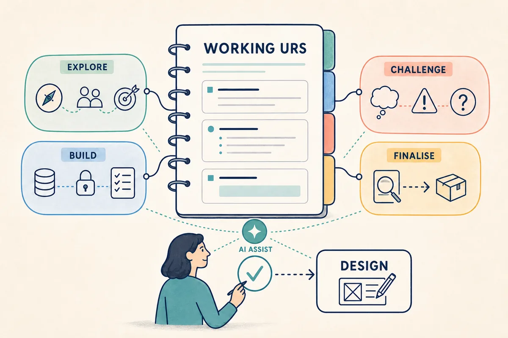
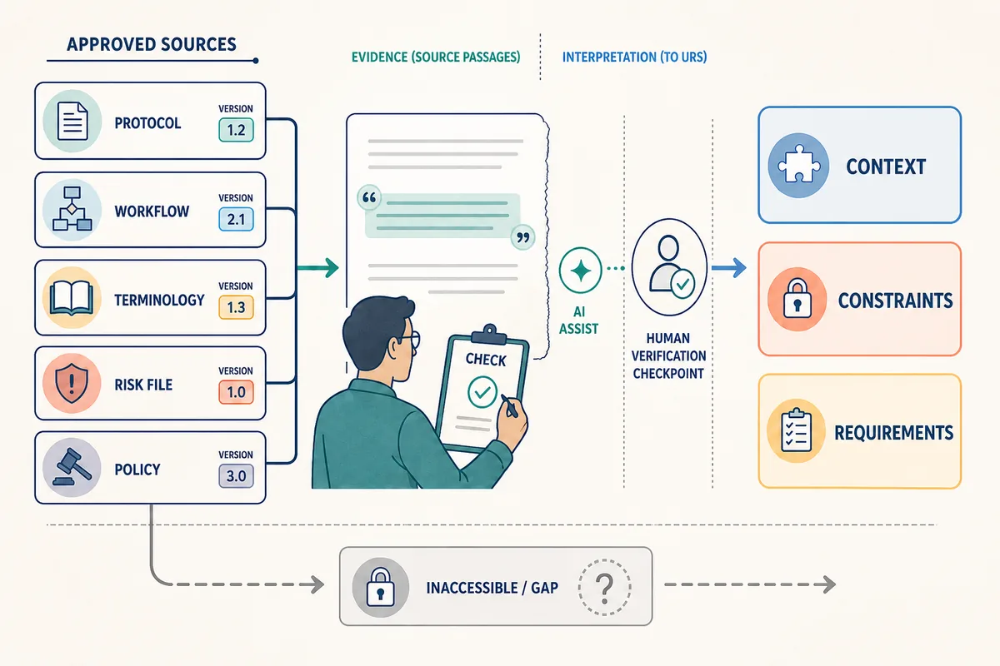
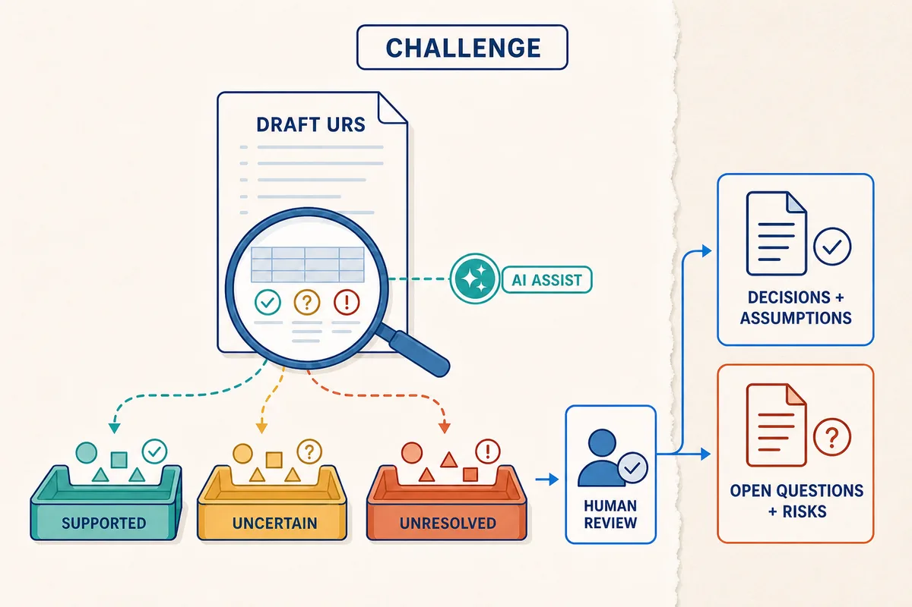
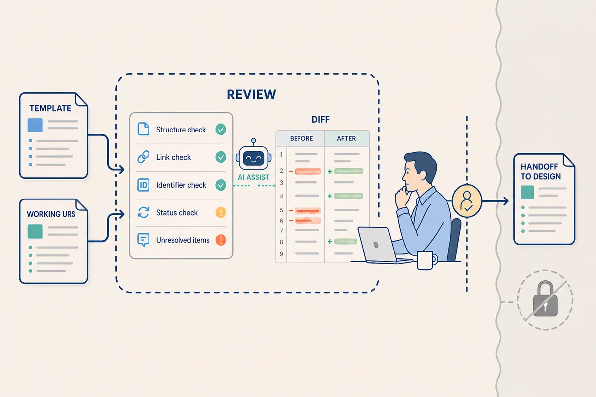

PLAYBOOK 02: AI-ASSISTED PLANNING

# 1. Purpose

This playbook builds on Playbook 01 and follows the [example URS](artifacts/urs-example.md), which was built from the [URS template](artifacts/urs-template.md). A team is extending a diagnostic application used for clinical tests. For a trial, the sponsor wants authorised clinicians to record medication given to a participant between pre-treatment and post-treatment assessments. The application records the medication and timing; it does not administer medication or analyse efficacy.

It shows how four activities build one working URS: Explore, Build, Challenge, and Finalise. Ask, Search, and Act describe how the work is done, not how Planning is structured.

# 2. Planning Activities

The proposed change adds medication recording between selected assessments. Planning starts one **working URS** from the [URS template](artifacts/urs-template.md). Each phase updates different sections of that document; the final review confirms it is ready for Design. Design uses the URS to define detailed requirements, options, interfaces, and acceptance criteria.

| Planning activity | Primary AI concepts | Planning output |
| --- | --- | --- |
| Explore | Prompt Engineering; Generation | Update purpose, users, outcome, and scope. |
| Build | Context Engineering; Provenance | Define broad requirements from the context and update sources, constraints, boundaries, and terminology. |
| Challenge | Evaluation; Risks | Add assumptions, risks, decisions, and open questions. |
| Finalise | Structured Output; Permissions | Review the URS and prepare the Design handoff. |

*AI can assist across all four activities; the working URS still moves forward through human-verified evidence and decisions.*

Modes can combine: Explore uses Ask, Build uses Search, Challenge may use both, and Finalise may use a bounded Act task. All follow the Loop from Playbook 01. Agentic changes remain proposals until a person verifies them.

Choose the least capable approved setup. An online conversational model suits supplied-context work; a local model suits restricted or offline work; an agentic interview skill can propose live URS updates from stakeholder answers or sources. The skill may use an online or local model, but people verify evidence, confirm decisions, and approve the URS for Design.

# 3. Explore

Start the working URS from the [URS template](artifacts/urs-template.md). Explore the medication-recording need before proposing a solution. Use a conversational model manually with only the sponsor's change idea and a short approved research excerpt. This is an Ask interaction, not an agentic interview or document-editing task. Discuss the output with stakeholders before updating the working URS.

This phase builds the URS's **Purpose and Scope** and **Users and Outcome** sections. Reviewers check that the options are distinct, grounded, and interface-neutral. Accepted material goes into those sections; detailed requirements and unresolved issues come later.

> The sponsor wants authorised clinicians to record medication given to a trial participant between the pre-treatment and post-treatment efficacy assessments. Using this change idea and the short research excerpt, suggest three concise ways to describe the need and intended outcome. Keep each option brief and non-technical. Do not write requirements or propose a solution.

*AI can propose candidate framing; people clarify the user, need, and outcome before deciding how medication recording will work.*

# 4. Build

Build the context needed for the URS from approved planning sources and existing evidence: the current workflow, protocol timing, terminology, data standards, risk files, policies, and support records. Use manual Search to verify sources, or give an interview skill read-only access to suggest citations and gaps. If permitted, it can add proposed source links to the working URS during the session; a reviewer must approve each source.

This phase updates the template's **Context and Sources**, **Constraints and Boundaries**, terminology, and **User Requirements** sections. It turns the accepted need and context into broad, non-technical requirements. Reviewers verify cited passages and check that each requirement expresses a supported user or business need; unsupported claims are removed or investigated again.

> Search the approved Planning sources for information relevant to this change. List concise, non-technical supported needs, constraints, conflicts, and gaps with source references. Separate source statements from interpretation and note inaccessible sources. Add proposed entries to the working URS template's **Context and Sources**, **Constraints and Boundaries**, and **User Requirements** sections. Write broad requirements from the supported needs; do not define detailed software behaviour, identify risks, or make decisions.

*AI can help extract candidate findings; people verify cited passages, choose the context, and keep findings traceable.*

# 5. Challenge

This phase evaluates the context and updates the template's **Decisions and Assumptions** and **Open Questions and Risks** sections. It considers the implications of unclear responsibility, wrong participant or assessment links, timing errors, incomplete records, inappropriate access, duplicates, and accidental efficacy conclusions without changing the requirements.

Reviewers confirm coverage and evidence, apply any agreed severity method, assign questions, and record decisions for Design. AI does not accept residual risk.

> Review the draft medication-recording URS and its sources. Identify concise, non-technical assumptions, risks, missing information, and stakeholder questions. Cover participant and assessment association, timing, corrections, duplicate records, authorised access, and the boundary excluding medication administration and efficacy analysis. Add proposed entries to the working URS template's **Decisions and Assumptions** and **Open Questions and Risks** sections, with sources and a change log. Do not change the requirements, accept risks, or make policy or design decisions.

*AI can surface and classify candidate findings; people review what they mean without rewriting requirements or accepting residual risk.*

# 6. Finalise

Finalise adds no new content. Use document or repository tools to compare the working URS with the [User Requirements Specification Template](artifacts/urs-template.md), check required sections, headings, identifiers, links, owners, statuses, and open items, and report any differences. A person reviews proposed corrections and prepares the **Handoff to Design**.

> Use an available document or repository tool to check the working medication-recording URS against the [User Requirements Specification Template](artifacts/urs-template.md). Report missing sections, broken links, duplicate identifiers, inconsistent statuses, and unresolved items. Propose only concise, non-technical corrections and show a change log. Do not add requirements, publish the document, approve its contents, accept risks, or make design decisions.

*AI can prepare checks and a diff; people review corrections, approve the URS, and hand it to Design.*

# 7. Summary

The four activities update one working URS built from the [URS template](artifacts/urs-template.md). This is not a prescriptive process: teams can revisit activities and update different sections as evidence, decisions, and questions change. The [example URS](artifacts/urs-example.md) shows the completed Design handoff. AI can propose updates, but people verify evidence, decide, and approve.

Ask, Search, and Act can support any activity. The human-led Loop keeps outcomes, evidence, access, checks, and decisions connected through the handoff to Design.

# 8. Appendix A

| Playbook section | Relevant URS sections | Output |
| --- | --- | --- |
| 3. Explore | Purpose and Scope; Users and Outcome | Update the template with the need, outcome, users, and scope. |
| 4. Build | Context and Sources; Constraints and Boundaries; User Requirements | Update the template with evidence, boundaries, and broad requirements. |
| 5. Challenge | Decisions and Assumptions; Open Questions and Risks | Record uncertainty, risks, decisions, and owners. |
| 6. Finalise | All sections; Handoff to Design | Review the working URS and prepare the handoff. |
