PLAYBOOK 02: AI CONCEPTS

# 1. Purpose

This playbook explains the main concepts behind modern AI systems in accessible language. The aim is understanding rather than implementation: technical terms are included because they appear frequently in AI products and discussions, but each is explained in terms of how it fits into the overall picture.

# 2. Introduction

**Artificial intelligence (AI)** is a broad term for systems that perform tasks associated with language, perception, prediction, reasoning, decision support, or action. The field of AI covers a broad spectrum of disciplines spanning machine learning, deep learning, generative AI and models such as foundation models, large language models (LLMs), and multimodal models.

This guide will focus primarily on the concepts of agentic and generative AI. AI is now more than just a model. It covers models, tokens, prompts, context, retrieval, memory, tools, agents, harnesses, skills, integrations, evaluation, and related ideas that can be used together to assist with many creative, technical, and scientific workflows.

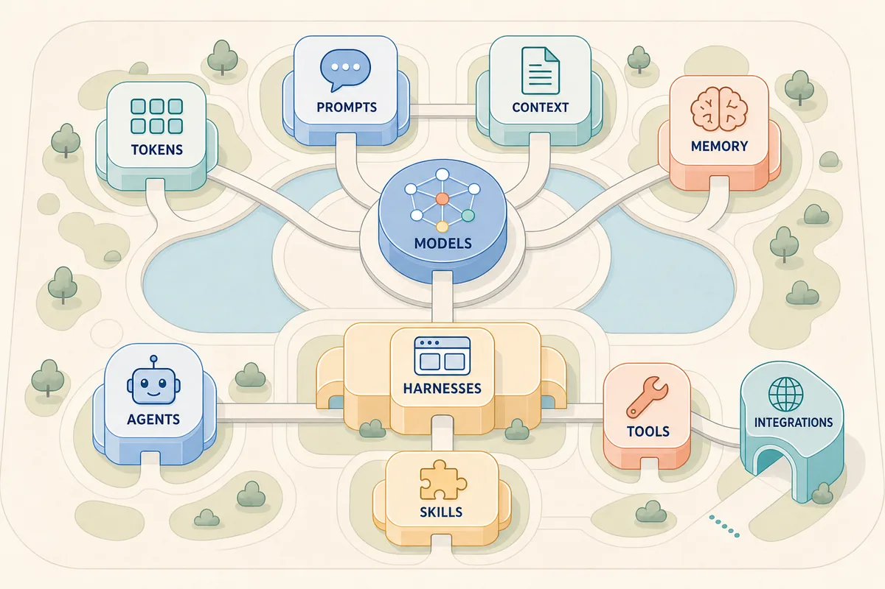

*These concepts form a connected AI environment: the model is central to generation, while the surrounding information, coordination, capability, and connection layers shape what the complete system can do.*

# 3. Core Concepts

This chapter starts with the model itself, follows how frontier organizations create and deploy models, and then explains how language models receive and generate content.

## Models

### Model Basics

A **model** is a learned mathematical system that turns input into output. Language models generate text or code, image models interpret or create images, speech models process audio, and embedding models turn content into numbers for similarity search. A model has an **architecture**, which is the overall design of its calculations, and **parameters**, or weights, which are the values learned during training. No single parameter contains one complete fact or rule; their combined values produce the model's behavior. Unlike conventional software, a model is not built entirely from instructions written line by line, but learns patterns from examples.

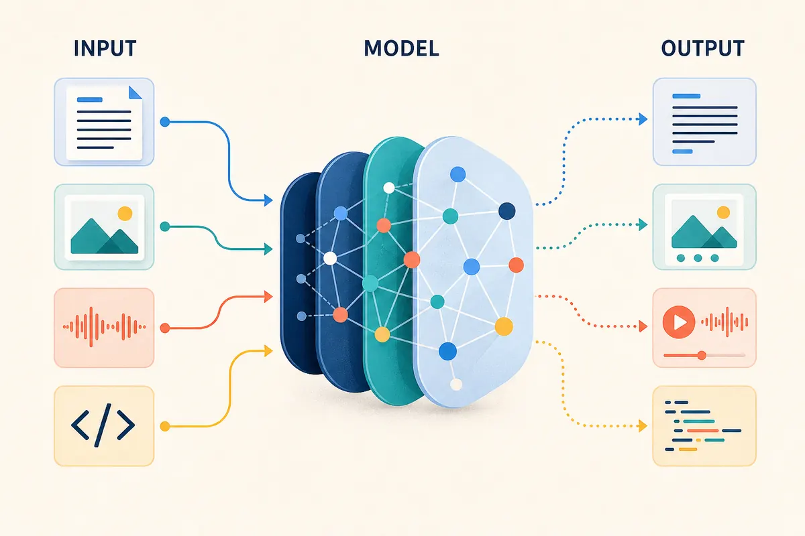

*A model learns patterns that allow it to transform inputs into outputs; it does not store a separate rule or fact for each response.*

### Foundation Models

Foundation models are mainly created by specialist organizations with large research, engineering, data, computing, safety, and operations capabilities. OpenAI and Anthropic are well-known examples of organizations that develop and operate frontier models, while other organizations create frontier, specialist, or open-weight models. These organizations may create, publish, and operate their own models; other providers host models, while AI product builders combine them with instructions, data, tools, and user interfaces.

### Model Creation

Frontier model creation is a large-scale, iterative process. Broad pretraining builds a base model from prepared data; post-training shapes how it responds; evaluation informs whether it is improved, restricted, or released. Exact methods differ and are not always public.

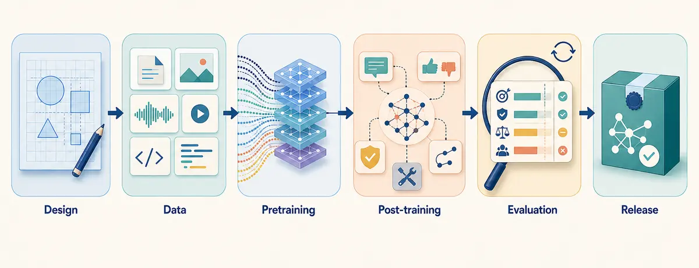

*Model creation progresses through six broad stages; evaluation can lead to further iteration or a release decision.*

| Stage | What happens |
| --- | --- |
| Design | Choose the model's content types, capabilities, scale, and architecture, commonly a transformer for LLMs. |
| Data | Collect, filter, balance, deduplicate, and prepare material that shapes knowledge, gaps, and bias. |
| Pretraining | Predict content at scale and adjust parameters to produce a base model. |
| Post-training | Use instructions, feedback, safety work, reasoning, and tool examples to shape behavior. |
| Evaluation | Test capabilities, limitations, safety, and reliability. |
| Release | Package the weights, tokenizer, settings, identity, and available guidance as a versioned release. |

### Deployment

Using a trained model to produce output is called **inference**. Model-serving software loads the release onto suitable computing hardware, processes requests, and exposes responses through an application or API. A provider may also add identity checks, usage limits, logging, safety features, routing, and billing. The provider can operate the model as a managed service, or an organization can host available weights in its own infrastructure or device; this choice affects control, cost, speed, data flow, maintenance, and version management.

### Model Types

Models are commonly described by their level of capability, access to their weights, and openness of their supporting artifacts. These labels answer different questions and can overlap: a model may be both frontier and proprietary, while an open-weight release may provide weights without disclosing its full training data or creation process.

| Term | Meaning | Examples (publisher, home country) |
| --- | --- | --- |
| Frontier | Near the leading edge of general capability at a point in time. | [GPT-5.6 Sol](https://platform.openai.com/docs/models/gpt-5.6-sol), OpenAI, United States; [Claude Fable 5](https://docs.anthropic.com/en/docs/about-claude/models/introducing-claude-fable-5-and-claude-mythos-5), Anthropic, United States; [Mistral Medium 3.5](https://docs.mistral.ai/models/model-cards/mistral-medium-3-5-26-04), Mistral AI, France. Mistral describes Medium 3.5 as both frontier-class and open-weight. |
| Proprietary or closed | Weights are not provided; access is normally through a provider service. | [GPT-5.6 Sol](https://platform.openai.com/docs/models/gpt-5.6-sol), OpenAI, United States; [Claude Fable 5](https://docs.anthropic.com/en/docs/about-claude/models/introducing-claude-fable-5-and-claude-mythos-5), Anthropic, United States. |
| Open-weight | Trained weights can be downloaded and run under a licence. | [Mistral Medium 3.5](https://docs.mistral.ai/models/model-cards/mistral-medium-3-5-26-04), Mistral AI, France; [Llama 4](https://github.com/meta-llama/llama-models), Meta, United States; [Qwen3-235B-A22B-Thinking-2507](https://huggingface.co/Qwen/Qwen3-235B-A22B-Thinking-2507), Alibaba Cloud, China. |
| Open-source | Under the [Open Source AI Definition](https://opensource.org/ai/open-source-ai-definition), this requires freedoms to use, study, modify, and share, supported by weights, code, and sufficient training-data information. | [Apertus](https://www.swiss-ai.org/apertus), Swiss AI Initiative, Switzerland; [Pythia](https://github.com/EleutherAI/pythia), EleutherAI, United States. Both publish broad model, code, data, and training artifacts. |

Examples were checked on 26 July 2026. Publisher and home country identify the organization responsible for the referenced release, not every legal entity, hosting region, or data-processing location. Model families contain different releases, licences can differ, and frontier status changes as capabilities advance; verify the specific release and licence before applying a label.

## Tokens

### Token Basics

A language model does not read and write text as complete sentences in the way a person does. It works with small units called **tokens**. Before content reaches the model, a **tokenizer** divides it into tokens and represents each one in a form the model can process. When the model responds, the tokenizer turns the generated tokens back into readable text.

### Tokenization

A token may be a whole word, part of a word, punctuation, spacing, a number, or a code symbol. Common words may fit into one token, while long or unusual words may be divided into several. Token boundaries do not necessarily match word boundaries, and different models can divide the same text differently because they use different tokenizers.

The tokenizer assigns a numerical identifier, called a **token ID**, to each token. The model converts these identifiers into internal numerical representations that it can process. Generated token IDs are ultimately converted back into readable content by the tokenizer.

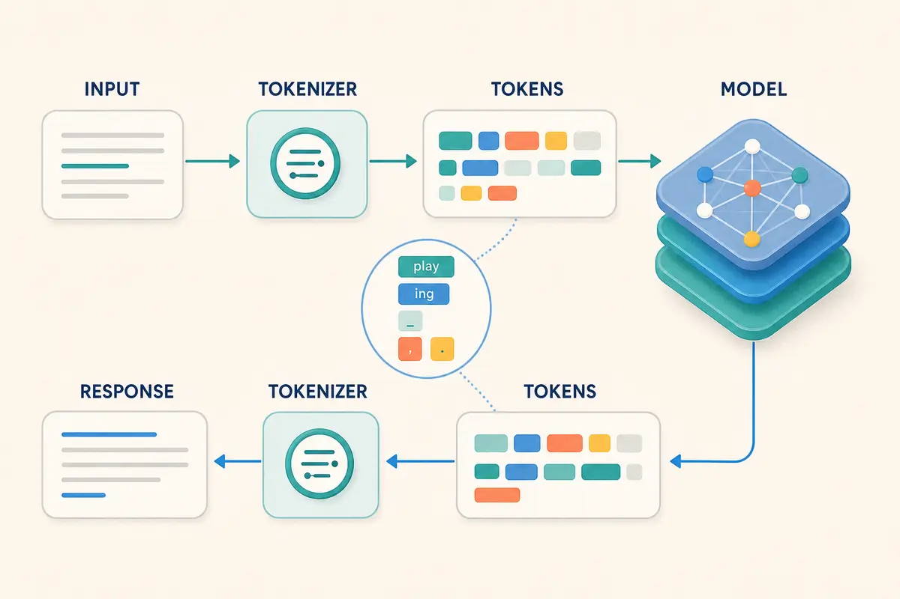

This is a high-level conceptual view of tokenization. The illustrated token boundaries are examples and vary by tokenizer; the diagram omits token IDs, the model's internal representations, and service implementation details. At a high level, the workflow is:

1. **Prepare the input.** The AI product combines the content to be sent to the model.
2. **Tokenize the input.** The tokenizer divides the assembled input into tokens and maps them to input token IDs.
3. **Process the input.** The model converts the input token IDs into internal representations and processes them.
4. **Generate output IDs.** The model produces output token IDs one at a time, as explained in the Generation section.
5. **Decode the output.** The tokenizer converts the generated token IDs into the text shown to the user.

### Why Tokens Matter

Tokens matter because:

- **Limits:** Input and output allowances are measured in tokens rather than words or pages.
- **Capacity:** Instructions, conversation history, supplied documents, retrieved material, tool results, and the response all compete for token space.
- **Length:** A token count cannot be inferred precisely from a document's page or word count, especially for code, tables, numbers, or mixed languages.
- **Processing time:** Processing more input or generating more output can increase response time.
- **Output behavior:** Maximum-token settings can stop a response before it is complete; they do not instruct the model to make every answer exactly that length.

### Token Cost

Many AI services calculate usage from the number of input and output tokens processed. Input tokens can include application instructions, conversation history, supplied or retrieved content, and tool results, not just the latest user message. Output tokens are the tokens generated in the response and may have a different price from input tokens. Rates vary by model and provider, while some products include token usage within a subscription or charge for it indirectly. Repeatedly supplying large documents or maintaining a long conversation can therefore increase cost even when each new request is short.

## Context

### Context Basics

**Context** is the information available to a model while it generates a response. It can include instructions, conversation history, documents, retrieved information, tool definitions, and tool results. The model can use only the context it receives; it does not automatically have access to other conversations, files, systems, or current events.

### Context Windows

The **context window** is the maximum token space available to the model at one time. It is measured in tokens rather than file size, pages, or words. At a basic level, it is like a tank with finite capacity: the assembled input fills part of the tank, while the generated response uses the remaining space. Depending on the model and product, hidden reasoning tokens may also use this capacity even though they are not shown in the response. Generated tool calls use output capacity, while tool results use input capacity when they are sent to the model in a later request.

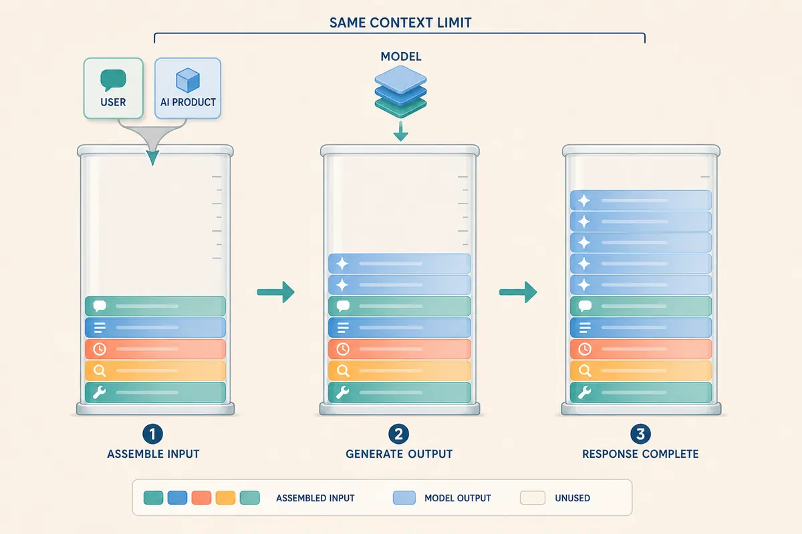

*The AI product assembles the input first. The model then generates output tokens into the remaining context space, and unused capacity may remain when the response is complete.*

If the input and generated tokens would exceed the window, the model service may reject the request or shorten the possible output, while the AI product may reduce the input through selection, truncation, or compaction. A response can stop incomplete if generation reaches an output or context limit. The behavior is product-specific and may not be visible to the user.

A larger context window can hold more information but does not guarantee that the model will use every detail well. Performance can degrade before the limit when relevant information is buried, repeated, contradicted, surrounded by distractions, or placed where the model gives it less attention. This is sometimes informally called the **"dumb zone"** and is related to the **"lost in the middle"** effect. It is not a fixed region or threshold; it varies by model, task, content, and information position.

### Context Across Requests

Each model request receives separately assembled context. Starting a new conversation, session, or thread normally excludes previous conversation history, although the product may still add persistent instructions or other retained information. Within a conversation, history is available only when the product includes it, either in full or through selected, truncated, or summarized earlier turns. A single user turn may involve several model requests, such as a tool call followed by a request containing the result, and each receives its own context.

### Compaction

Long conversations and multi-step tasks can approach the context-window limit. The AI product may remove older material, summarize it, preserve selected facts, or create a handoff note to make space. This process is called **compaction**. Compaction allows work to continue, but its summary is a reduced version of the earlier context. Qualifications, open questions, rejected options, decisions, and source references can be lost or changed.

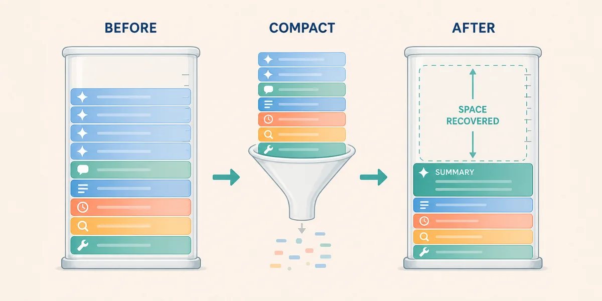

*Compaction replaces detailed earlier context with a smaller summary, recovering capacity while potentially losing useful nuance and references.*

### Prompt Caching

Some systems can reuse earlier processing for unchanged input, often a repeated prefix. This is called **prompt caching**, and may also be referred to as **context caching**. It can reduce response time or token-processing cost. It does not expand the context window, create memory, or return a previous answer; the model still generates a new response.

### Temporary Context

Putting information into context makes it temporarily available to the model for that request. It does not retrain the model or permanently add the information to the model's weights.

## Generation

### Generation Basics

**Generation** is the process a model uses to produce output from the context it receives. An LLM builds a response one token at a time rather than retrieving a complete sentence or answer as a fixed block. Each generated token becomes part of the context used to generate the next one, until the model reaches a natural endpoint or is stopped.

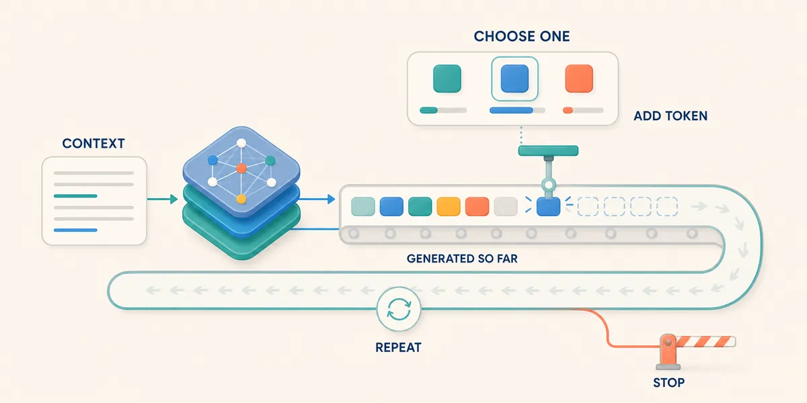

*The model selects and adds one token at a time. The expanded response then influences the next selection until generation stops.*

### Token Selection

At each step, the model assigns scores to possible next tokens based on the context and the tokens generated so far. A selection process then chooses one token, adds it to the response, and repeats the cycle. It may consistently favor the highest-scoring option or allow controlled variation among likely options. These scores reflect patterns learned by the model, not verified facts or calibrated confidence in the completed answer. A token can fit the preceding text well while continuing an incorrect claim or flawed assumption. Fluent generation is therefore not evidence of accuracy.

### Generation Settings

Some AI products allow the client application to influence generation through request settings, such as the response length and the amount of variation allowed during token selection. The available controls and their behavior vary by model and service. They can shape the output but do not make it fully repeatable; results may also change when the model version, service, context, tools, application instructions, or settings change.

### Reasoning-Oriented Models

Some models spend more processing time analyzing a problem or comparing possible answers before producing a final response. This is often described as **reasoning** and can improve performance on complex tasks, but it cannot correct missing context or guarantee sound assumptions and conclusions. Reasoning may consume tokens and context capacity even when the intermediate work is hidden or summarized. Inspectable sources, calculations, actions, and results remain more useful than an unsupported claim that the model reasoned carefully.

### Structured Output

A request can specify a particular format, while some systems can enforce a structure such as defined JSON fields and value types. Enforced structured output makes a response easier for software to read and validate, but it controls shape rather than truth. Check both that the required fields and value types are present and that their values are correct, supported, and internally consistent.

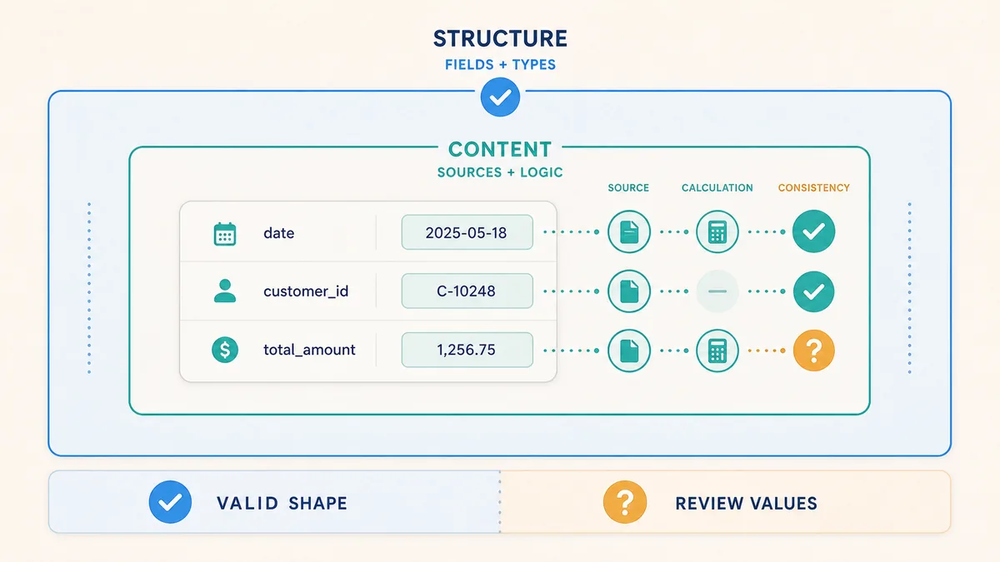

*A response can have a valid structure while its values still require verification against sources and logic.*

### Stopping Generation

Generation can end because the model produces an end marker, reaches a maximum output or context limit, encounters a defined stop sequence, or is stopped by the product or model service. When a limit is reached, the response may end midway through a sentence, code block, or structured record. Some services return a completion status or **finish reason** that distinguishes a normal endpoint from a length limit, content restriction, or other interruption, making it easier to detect when a stopped response is not a completed answer. A product may use **streaming** to display tokens as they are generated rather than wait for the completed response.

# 4. Information Pathways

A model becomes more useful when it receives clear direction and relevant information. This chapter moves from instructions to external knowledge and then to information retained across interactions.

## Prompt Engineering

A **prompt** is direction supplied to a model, such as an objective, instructions, constraints, examples, and a requested output. **Prompt engineering** improves that direction. Some products use "prompt" for all input sent to the model, but this playbook distinguishes the prompt from the broader context assembled around it. A useful prompt often contains the desired result, relevant background and sources, boundaries, steps, output formats, and evidence expected.

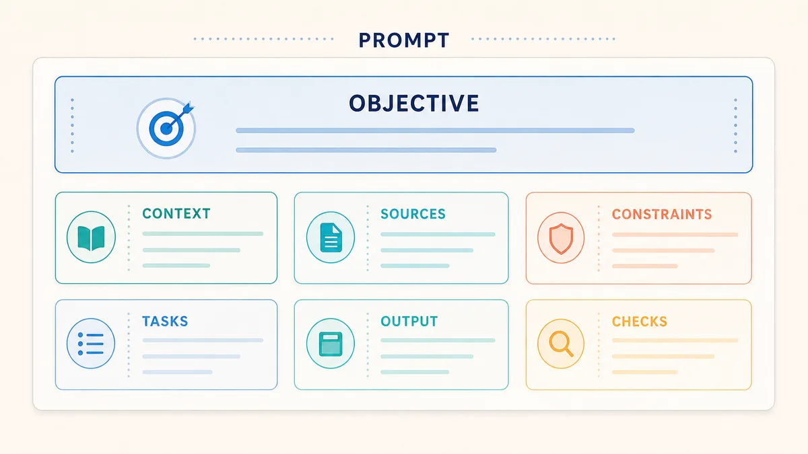

*A useful prompt can combine these components to make the requested work and its review criteria clearer; not every task requires every component.*

Compare the two prompts in the illustration below. The second prompt defines the work and makes the answer easier to review. Two document icons feed the same supplied material into two prompts. The vague request produces a general summary with unresolved review questions, while the specific request produces a categorized comparison with citations and separated interpretations.

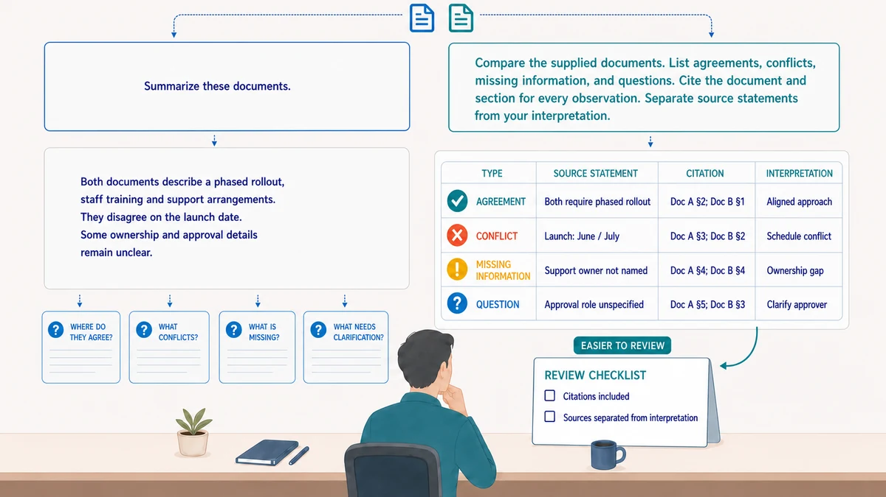

*The more specific prompt makes the expected comparison, evidence, and review criteria visible; it structures the response without guaranteeing that the content is correct.*

One common prompting technique involves prompting the model to operate from a particular viewpoint. This can sometimes be called **Perspective** prompting or **Role-based** prompting. This can focus attention, but telling a model to "act as an expert" does not give it qualifications or authority.

A prompt used repeatedly can become a versioned asset containing task instructions, examples, input placeholders, the expected output, checks, and known prompt-specific limitations. Changing this asset can change behavior even when the model remains the same. It structures the direction for a model request; it does not change model weights or supply missing current information unless that information is included in the request.

## Context Engineering

Prompt engineering improves the direction given to a model. **Context engineering** addresses the broader information environment by deciding what the model should receive, where that information comes from, and how it should be organized. It aims to provide relevant instructions and evidence without burying them in unnecessary, conflicting, or outdated material.

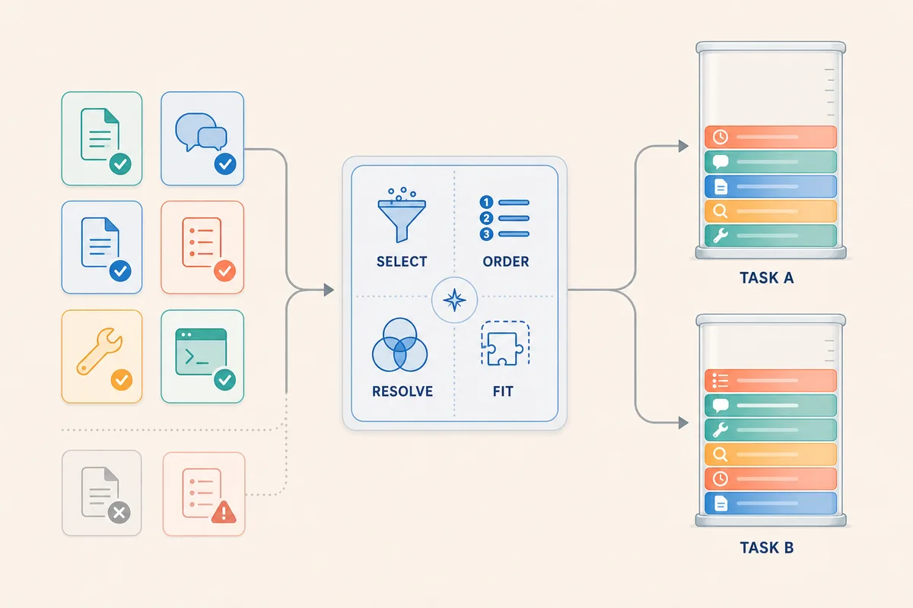

*Context engineering defines reusable selection and organization decisions. Each task can then assemble a different context from the available information.*

**Context assembly** applies these decisions to an individual model request. The AI product combines the prompt with selected instructions, history, sources, state, tool definitions, and results, and may omit or summarize material to fit the task and context window. Because selection and ordering influence the response, context engineering also considers how conflicts, missing information, and older material will be recognized. Products that show active instructions, selected sources, and tool results make the assembled context easier to inspect.

## Retrieval-Augmented Generation

Retrieval-augmented generation (RAG) is an advanced topic with many design and implementation choices. This section provides only a brief conceptual outline of its purpose and basic workflow.

RAG combines retrieval from an external collection with model context. RAG supplies current, private, or specialist information that may not be present in the model's weights. It is useful for large or changing collections and can make answers easier to inspect when source references are preserved. It does not change the underlying model or the model's weights in any way.

Building out a RAG implementation is a separate engineering task. An **ingestion pipeline** extracts source content, uses optical character recognition (OCR) when needed, divides it into **chunks**, and records metadata such as source, version, section, date, and access details. An **embedding model** may convert each chunk into a numerical **vector** representing aspects of its meaning. Original documents usually remain in a source system, document store, or object store; chunks and metadata are held in a search index; and vectors are held in a **vector index** provided by a **vector database** or vector-search features in another database or search engine. The indexes must be updated when sources change.


*RAG prepares searchable material separately from using it: each request retrieves and reranks candidates, and only selected chunks enter the model's context.*

For each request, the system finds candidate chunks using keywords, metadata filters, **vector similarity search**, or **hybrid search**. Ranking or **reranking** selects the most relevant chunks, which are added to the request context with source references before the model generates an answer.

RAG can fail when sources are absent, outdated, inaccessible, or parsed incorrectly; chunking, indexing, search, or ranking can miss decisive information; and the model can ignore or misinterpret what was retrieved. A citation to a real source may still not support the generated claim.

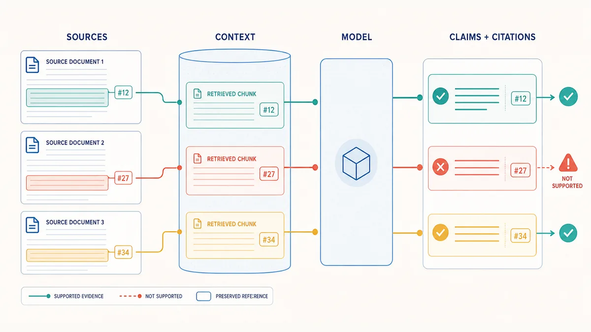

*Preserved references make a claim traceable, but reviewers must still check whether the cited source actually supports it.*

## Memory Management

**Memory management** determines what information an AI product retains for possible later use. Whilst **context** is information supplied to the model now, **memory** is stored information available for later selection. It can include conversation summaries, user preferences, or other retained facts. Stored memory is not automatically part of the current context.

The product design and user choices establish what may be remembered. The model may identify or summarize a candidate memory, but it cannot persist information by itself. The AI product applies storage rules and any required confirmation before writing accepted information to an external store. On a later request, it may retrieve relevant memory and place it into context, where the model may use, ignore, or misapply it. The AI product therefore controls storage and reuse even when the model proposes what to remember.

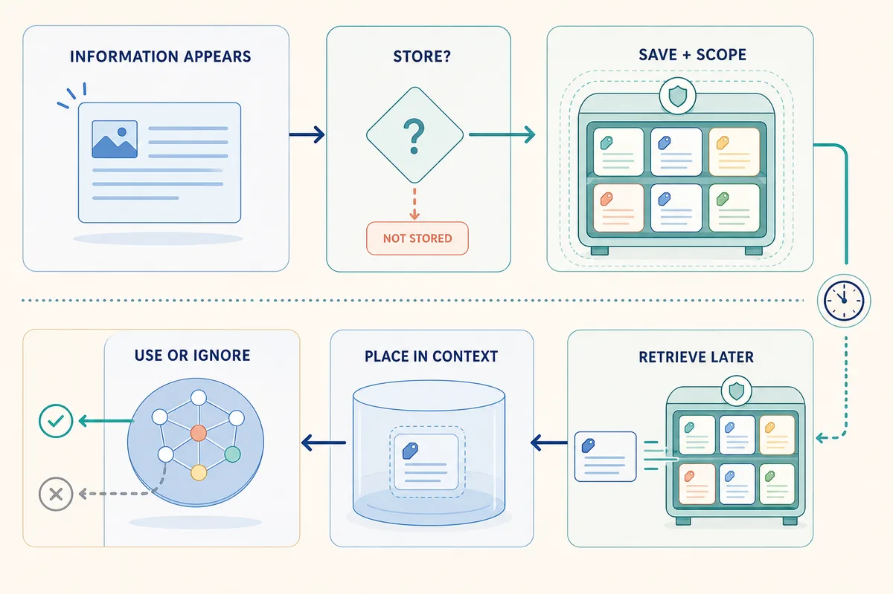

*Memory is stored for possible later retrieval; only selected memory enters the current context.*

Memory can be scoped to a conversation, user, workspace, or organization and retained for different periods. Wider scope and longer retention can improve continuity but increase the impact of stale, incorrect, sensitive, or over-shared information. Memory management should preserve the source, scope, retention period, and access rules and support inspection, correction, replacement, and deletion without allowing information to cross intended boundaries.

# 5. Agentic Systems

An **agentic system** allows a model to pursue a goal across one or more steps by selecting actions, using tools, and responding to results. This chapter starts with agents and the harnesses that support them, then explains the tools, permissions, and coordination involved.

Terminology in this area is not standardized. In this playbook, an **agent** describes goal-directed behavior, a **harness** is the runtime and supporting software around model-based work, and a **tool** performs a specific external operation. Products and frameworks package these responsibilities differently and may call the complete system an agent. An agent may propose a tool call or delegation, while the harness typically performs the invocation and applies controls, but the exact boundary varies by implementation.

## Agents

An **agent** is a goal-directed decision loop that observes its current state, selects an action, inspects the result, and continues until it finishes or must stop:

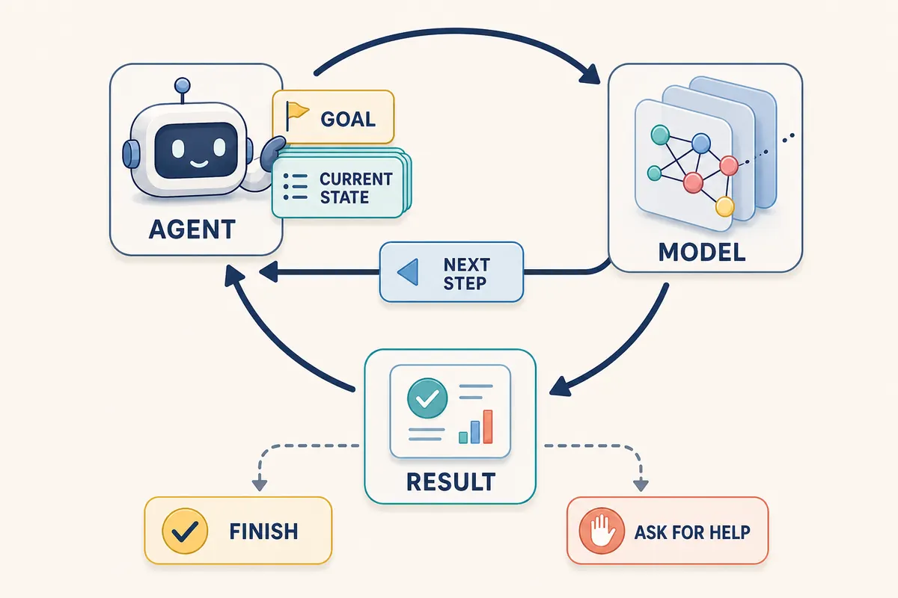

*An agent repeatedly brings its goal and current state to the model, uses the proposed next step, and updates the loop from the result until it finishes or needs help.*

An agent differs from a **workflow**, which follows steps and branches designed in advance. Many systems combine both by placing a bounded agent inside a fixed workflow. A bounded agent may finish after one action, while another may plan, use several systems, revise its work, and communicate a result. Workflows suit stable and predictable routes; agents are useful when the next step depends on exploration or feedback.

Agents need explicit boundaries, including:

- Allowed tools, information, and actions.
- Maximum steps, time, or cost.
- Conditions requiring confirmation.
- Completion criteria.
- Errors or uncertainty that require help.
- A way to report partial work rather than hide failure.

The workflow or agent design defines these boundaries, while the harness or external controls must enforce and record them. Instructions alone are not an enforcement mechanism.

## Harnesses

The **harness** is the runtime and supporting software that hosts model interactions, workflows, and agents. It may assemble context, maintain state, invoke models and tools, create agent instances, enforce permissions and limits, manage retries and handoffs, and record what happened.

A harness does not need to be agentic: it can support a single model response, a fixed workflow, or a goal-directed agent loop. For each model call, it can construct the request, expose permitted operations, validate tool requests, and return results. Across a longer task, it can preserve state, apply budgets and stop conditions, coordinate handoffs, and expose sources, actions, errors, and traces for inspection. These responsibilities may be implemented in one application or distributed across several services.

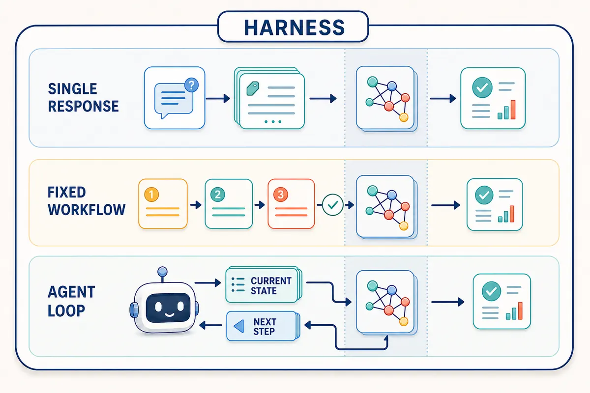

*The same harness can coordinate a single response, a predefined workflow, or a repeating agent loop; the shaded column distinguishes model calls from the surrounding coordination flow.*

The coordination of model calls, tools, checks, and handoffs is often called **orchestration**. A harness may decompose a task into stages, use plans or checklists, preserve temporary task state, validate intermediate results, or ask the model to critique and revise a draft. Poor orchestration can repeat errors, hide missing context, or allow a task to loop.

A harness may also support **delegation** by creating another agent instance for a bounded subtask. A delegated instance is often called a **subagent**, while a **multi-agent system** uses several agent instances that contribute to or coordinate around a larger goal. Separate instances can isolate information, parallelize work, or apply specialist skills, but they add coordination and cost. The harness or a coordinating agent must define the subtasks, manage their contexts, and combine the results; agents using the same model and sources are not automatically independent.

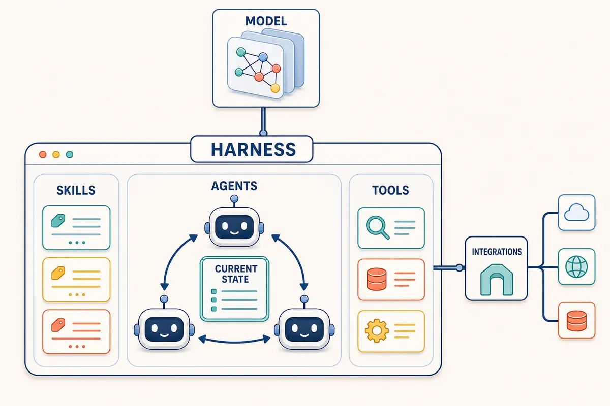

*The harness is the coordinating application: agents work through shared state, skills guide reusable procedures, tools expose permitted operations, and the application connects separately to models and external integrations.*

The same model can appear cautious in one harness and highly autonomous in another because the available context, tools, permissions, and task loop differ.

## Tools

A **tool** is an operation an AI system can request. With **tool calling**, the model requests an available operation using a tool name and input fields; the harness checks and runs the request, then returns the observed result to the model.

Frontier-model products commonly expose tool calls in the following categories, although names and implementations vary by harness:

| Category | Common model-facing examples | Windows analogue | Linux analogue |
| --- | --- | --- | --- |
| Search and retrieval | Web search, file search, semantic retrieval, and code search. | `Select-String`, `Get-ChildItem`, and search APIs. | `rg`, `find`, and search APIs. |
| File and repository operations | Read or write a file, apply a patch, inspect a diff, and use Git. | `Get-Content`, `Set-Content`, and `git`. | `cat`, `sed`, and `git`. |
| Command and code execution | Run a shell command, script, test runner, code interpreter, or sandboxed program. | PowerShell, Command Prompt, and Python. | Bash, `sh`, and Python. |
| Data query and calculation | Execute SQL, query structured data, use a calculator, or analyze a data frame. | `sqlcmd`, `sqlite3`, and PowerShell data commands. | `psql`, `sqlite3`, and Python data tools. |
| External service actions | Call a function, REST API, MCP tool, messaging service, or issue tracker. | `Invoke-RestMethod` and service-specific clients. | `curl` and service-specific clients. |

These operating-system examples are analogues rather than the model-facing tools themselves. A harness normally wraps the underlying command, API, or library in a defined tool interface and controls its inputs, credentials, permissions, and execution environment.

The interface or harness normally receives the user message, maintains the agent's task state, and sends an assembled request to the model. The model returns either generated text or a structured tool request. Saying that an agent "calls a tool" is useful shorthand for this decision within the agent loop; the harness or model provider performs the actual invocation.

```
user message
  -> harness assembles model request
  -> model returns text or a tool request
       -> text returns through the harness to the user
       -> harness or provider invokes the requested tool
            -> tool result enters context
            -> model continues
```

With a **client-side tool**, the harness validates the request, checks permissions, invokes the operation, and sends the result in another model request. With a **provider-side tool**, such as some web-search services, the model provider handles this internal loop and returns the resulting response or tool events to the harness. Some harnesses include web search, while others add it through MCP or a custom integration. Web search discovers sources; web fetch retrieves content from a known address.

In either arrangement, tool availability, access, and credentials come from the runtime rather than the model's weights. Tool use can fail through wrong selection, incorrect input, missing permission, changed system state, duplicate action, or misunderstanding of the result. Reading can still expose sensitive information, and a simple query can still have cost or access implications.

## Integrations

Integrations are a more advanced topic than individual tool calls, so this section provides only a brief conceptual outline. A **tool call** is one requested operation, while an **integration** is the broader connection between a harness and another system. One integration may expose several tools, readable resources, or event-driven capabilities.

Integrations can use built-in connectors, application programming interfaces (APIs), software development kits (SDKs), plugins, or protocols. They manage concerns such as authentication, credentials, data translation, connectivity, and the boundary across which requests and results travel. The harness still decides which integration features to expose to the model and under what permissions.

The **Model Context Protocol (MCP)** is one standard for connecting AI applications to external information and operations. An MCP server can expose **resources** for readable context, **tools** for callable operations, and **prompt templates** for reusable instructions. It may connect to files, repositories, databases, document systems, or remote services. MCP makes these connections more consistent but does not make them trustworthy: servers can receive data or credentials, reach other systems, perform actions, and return untrusted content.

## Permissions

A **permission** is authority to access information or perform an action. Tool availability, permission, and execution policy are separate: an operation may exist but not be exposed, an identity may lack authority to use it, or the application may require confirmation before it runs.

## Capabilities

A **capability** is something the complete AI system can do. It comes from several layers:

```
capability
  = model ability
  + available information
  + connected tools
  + granted permissions
  + harness behavior
  + time and computing budget
```

For example, a model may know how to write a command but have no execution tool; a tool may be available while network access is denied; and a user may hold a permission that the AI application does not receive.

## Skills

A **skill** is a reusable task procedure that may combine instructions, references, scripts, checks, and guidance for using tools. A prompt asset structures the direction for a model request, a skill supplies broader task know-how, and a tool exposes a callable operation.

Loading a skill can change behavior without changing model permissions. Skills can conflict, become outdated, or consume too much context, so their selection and version can affect the result.

# 6. Risks

The capabilities described in the previous chapters also create limitations and risks. These come from generated content, changing system components, untrusted information, and access to external actions.

## Hallucination

**Hallucination** is generated content that is unsupported, fabricated, or inconsistent with the relevant source or reality. Examples include invented citations, nonexistent features, false quotations, and claims about actions that never occurred. Grounding and tools can reduce some hallucinations but cannot eliminate them.

## Uncertainty

Confident wording is not a dependable measure of correctness. Better evidence comes from source support, repeatable checks, tool results, and measured performance on representative examples.

## Bias

Bias can enter through training data, examples, retrieval sources, labels, prompts, evaluation material, or user interpretation. It may appear as missing perspectives, stereotypes, uneven performance, or preference for common cases over rare ones.

## Drift

Behavior can change when any of these change:

- Model or provider version.
- Prompt or system instructions.
- Retrieved sources or search index.
- Tools and permissions.
- Memory and conversation state.
- Harness or user interface.

Evaluating only a model name misses much of the system that produces the result.

## Prompt Injection

**Prompt injection** occurs when untrusted content contains instructions intended to redirect the model or its tool use.

- **Direct prompt injection:** a user asks the system to ignore its intended task or reveal protected information.
- **Indirect prompt injection:** a document, web page, message, file, or tool result contains instructions aimed at the AI.

## AI Security

Other risks include:

- Disclosure of information through output, tool input, links, or messages.
- Misuse of credentials available to the AI application.
- Poisoned retrieved content or memory.
- Unsafe execution of generated code or commands.
- Secrets appearing in context, logs, or errors.
- Excessive permissions or autonomy.
- Runaway loops, cost, or resource use.

Useful protections include limiting information, tools, permissions, destinations, steps, and cost; treating external content as data rather than authority; checking tool input outside the model; requiring confirmation for consequential actions; and isolating reversible work. No prompt creates a complete security boundary, so enforcement also belongs in identity, applications, tools, networks, and target systems.

# 7. Assurance

Evaluation measures how an AI system behaves, while observability provides evidence about what happened during an interaction. Together they turn impressions of quality into inspectable information.

## Evaluation

An **evaluation**, or eval, checks AI behavior on defined examples. General benchmarks can compare models, while system-level evals test the complete product with its prompts, sources, tools, and harness.

**Evaluation Layers**

| Layer | Example question |
| --- | --- |
| Model | Can the model understand and perform the basic task? |
| Retrieval | Did the system find the decisive source? |
| Tool use | Did it choose the right tool and supply valid input? |
| Agent | Did it complete the goal within its boundaries? |
| Output | Is the result correct, complete, supported, and useful? |
| Operation | What are the response time, cost, failure, and correction rates? |

**Offline and Online Evals**

- **Offline evals:** run a fixed set of examples outside live use. They support repeatable comparison and regression testing.
- **Online evals:** observe sampled behavior and outcomes during real use. They reveal cases not anticipated beforehand.
- **Shadow evals:** run a candidate configuration without using its answer for the real task.
- **A/B evals:** compare alternatives by giving different cases or users different configurations.

**Ways to Judge an Output**

| Evaluator | Strength | Limitation |
| --- | --- | --- |
| Fixed check | Fast and repeatable for formats, exact values, calculations, or rules. | Covers only what has been encoded. |
| Source comparison | Tests whether claims match authoritative material. | Requires maintained expected sources. |
| Human expert | Can assess context, meaning, and usefulness. | Slower and affected by reviewer variation. |
| Model grader | Can assess large volumes against written criteria. | Can be inconsistent or share the same biases as the system. |
| Outcome measure | Connects use to observable success, correction, time, or cost. | Outcomes can be influenced by many factors. |

A **model-as-judge** eval asks one model to score, rank, or critique another output. It is useful when exact matching is too narrow, but should be compared with human judgments because it can prefer style over correctness or miss specialist errors.

**Building an Eval Set**

Useful examples include:

- Normal and common tasks.
- Boundary and unusual cases.
- Conflicting, missing, or outdated information.
- Ambiguous language.
- Tool and system failures.
- Prompt-injection attempts.
- Cases where the right behavior is to ask, abstain, or stop.

Define expected evidence and the seriousness of errors before looking at the model's output. Averages can hide a rare but important failure.

**Eval-Driven Development**

An eval-driven approach is:

1. Define the task and observable success.
2. Build representative examples.
3. Measure a baseline.
4. Change the model, prompt, retrieval, tool, or harness.
5. Compare results and inspect important failures.
6. Add newly discovered cases to the eval set.

Repeat evals when important parts of the AI system change.

## Observability

**Observability** helps explain what happened during an AI interaction. A trace can include:

- Model and settings.
- Prompt or prompt version.
- Retrieved sources.
- Tool requests, results, errors, and confirmations.
- Agent steps and stop reason.
- Time, token use, and cost.
- Output, user edits, and final outcome.

More logging is not always better because prompts and tool results can contain sensitive or confidential information.

## Provenance

**Provenance** records where material came from and how it changed, distinguishing supplied sources, retrieved information, tool evidence, generated proposals, human edits, and final decisions.

# 8. Application

The concepts can now be combined into practical choices. This chapter compares common approaches, follows one example through increasing levels of capability, and provides exercises for exploring the differences.

## Choosing Approaches

| Need | Start with | Add if needed |
| --- | --- | --- |
| Explain or transform supplied content | A clear prompt. | Examples or structured output. |
| Answer from current documents | RAG with references. | Better search, ranking, or filters. |
| Calculate or validate exactly | A deterministic tool. | A model to explain the result. |
| Explore many sources | A read-only search agent. | More sources or specialist tools. |
| Perform a variable multi-step task | A bounded agent. | Additional skills or subagents. |
| Repeat a stable task at scale | A defined workflow with evals. | A bounded agent step for variable cases. |
| Enforce an access or safety rule | A non-model system control. | Model detection as an additional signal. |

Use the simplest approach that provides enough information, capability, and reviewability for the task.

## Worked Example

Suppose an organization wants to compare several versions of policy documents and identify differences.

**Prompt-Only**

A person selects and supplies the relevant passages, then asks the model for a cited comparison. **Useful when:** the source set is small and a knowledgeable person can select it. **Weakness:** the person may omit the decisive passage or version.

**RAG**

The documents are indexed with titles, versions, dates, sections, and status. The system retrieves passages and asks the model to prepare a referenced comparison. **Useful when:** the collection is too large to select manually or changes regularly. **Weakness:** search may miss a term, choose an outdated document, or separate a statement from its qualification.

**Agent**

A read-only agent searches the collection, follows references, compares versions, and returns the sources inspected, its findings, and unresolved questions. **Useful when:** the route requires several searches and depends on what is found. **Weakness:** the agent may stop too early, search poorly, or assume that a failed search proves something is absent.

These are different patterns, not maturity levels. The simplest sufficient pattern is often the best choice.

## Practical Exercises

**Exercise 1: Context**

Ask the same question three ways:

1. With a long unstructured document.
2. With selected relevant passages.
3. With passages selected by retrieval.

Compare omissions, irrelevant content, references, and review effort.

**Exercise 2: Prompt Versus Tool**

Ask a model to calculate the difference between two lists. Then use a deterministic comparison tool and ask the model to explain the result. Compare correctness and traceability.

**Exercise 3: Capability Map**

For an AI product, draw the path from user to model, harness, tools, credentials, external systems, and logs. Mark what data crosses each boundary and what can be read or changed.

**Exercise 4: Indirect Prompt Injection**

In an isolated synthetic environment, place an unrelated instruction in a document the AI will read. Observe whether the AI treats it as data or follows it. Repeat with fewer permissions and stronger confirmation.

**Exercise 5: Small Eval**

Create ten examples for one task, including normal, ambiguous, conflicting, missing-information, and abstention cases. Define expected behavior before testing two prompts, models, or configurations.

# 9. Reference

## Glossary

| Term | Meaning |
| --- | --- |
| Agent | A system that selects actions dynamically while working toward a goal. |
| Architecture | The designed arrangement of a model's calculations. |
| Base model | A pretrained model before post-training for instruction following or another intended behavior. |
| Capability | Something the complete AI system can do. |
| Compaction | Shortening or summarizing state so a task can continue within a context limit. |
| Context window | The maximum token space available to a model at one time. |
| Embedding | Numbers representing aspects of meaning for similarity comparison. |
| Eval | A repeatable check of behavior on defined examples. |
| Fine-tuning | Further training used to shape model behavior. |
| Foundation model | A broadly trained model that can support many tasks. |
| Frontier model | A model near the leading edge of general capability at a point in time. |
| Grounding | Connecting an answer to supplied sources, data, or tool evidence. |
| Hallucination | Generated content unsupported by the relevant source or reality. |
| Harness | Software around a model that manages context, tools, permissions, state, and task execution. |
| Inference | Running a trained model to produce output. |
| Instruction-tuned model | A base model post-trained to follow requests or support intended interactions. |
| LLM | A language-focused foundation model. |
| MCP | Model Context Protocol, a standard way to connect AI applications to tools and information. |
| Memory | Stored information that may be selected for later context. |
| Model | A learned mathematical system that turns input into output. |
| Model grader | A model used to assess another generated output. |
| Open-weight model | A model whose trained weights can be downloaded and run under its licence. |
| Parameter | A numerical value learned during model training. |
| Permission | Authority to access information or perform an action. |
| Post-training | Further training used to shape a base model's behavior. |
| Prompt | Direction supplied to a model, such as an objective, instructions, constraints, or examples. |
| Prompt caching | Reuse of earlier prompt processing to reduce time or cost. |
| Prompt injection | Untrusted content intended to redirect model behavior or tool use. |
| RAG | Retrieval of external information for use while generating an answer. |
| Skill | A reusable task procedure combining instructions, references, scripts, checks, or tool guidance. |
| Structured output | Model output required to follow a defined format. |
| Token | A small unit of content processed or generated by a model. |
| Tokenizer | The component that converts content to and from tokens. |
| Tool | An external operation an AI system can request. |
| Workflow | Predesigned steps and branches, possibly including AI. |

## Key Takeaways

- A model is one part of an AI system; context, retrieval, tools, permissions, the harness, and evaluation shape the actual experience.
- Frontier organizations create foundation models through large-scale data preparation, pretraining, post-training, evaluation, and operation.
- Frontier describes relative capability; open-weight describes access to model weights.
- Tokens determine how content enters and leaves a language model, while the context window defines its temporary working space.
- Prompting shapes instructions; context engineering shapes the full information environment.
- RAG gives a model external information but introduces search, source, and citation failure points.
- Memory stores information for possible later use; it is not guaranteed to appear in context or remain correct.
- Tools provide operations, while permissions and the harness determine which actions are actually possible.
- Agents select steps dynamically; workflows define steps in advance; many systems combine both.
- Skills provide reusable know-how, and MCP provides a standard way to connect tools and information.
- Evals measure the complete system on defined examples; fluent output is not proof of correctness.
