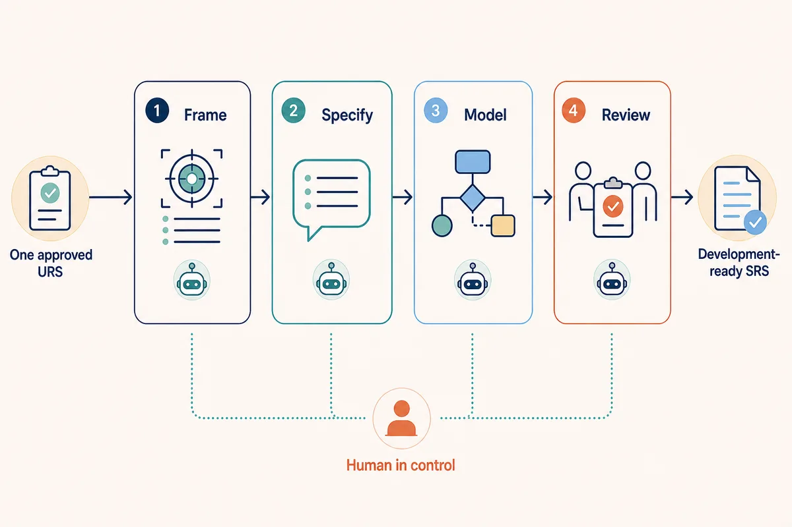
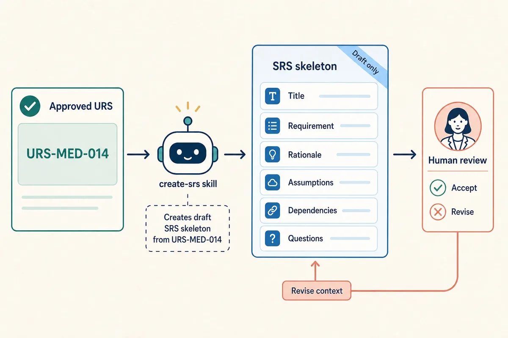
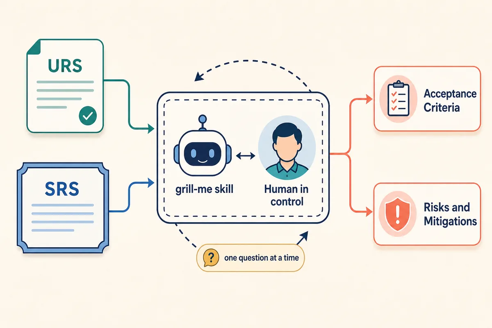
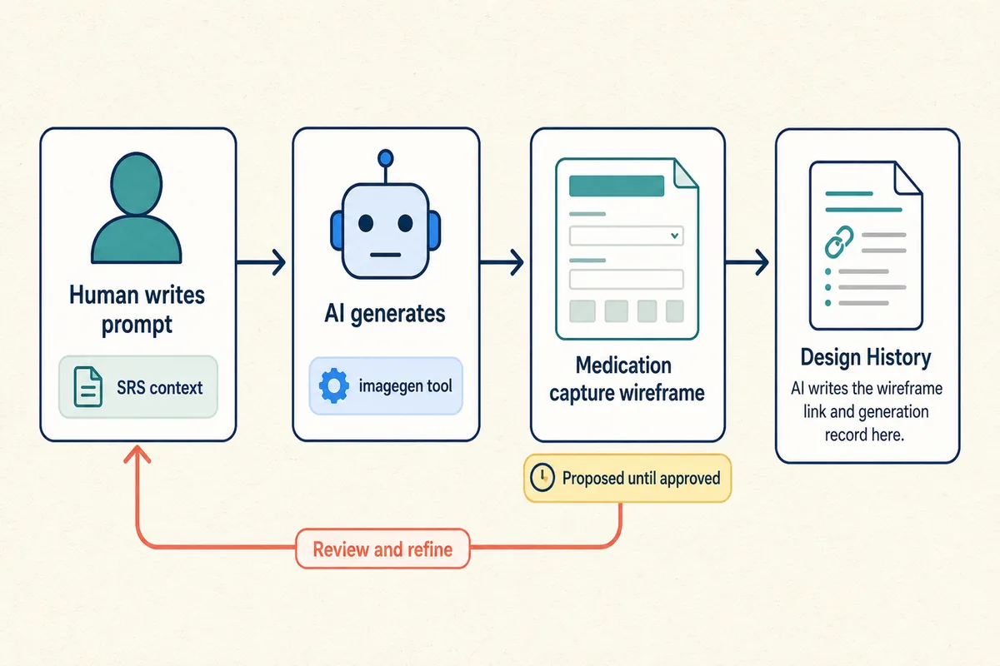
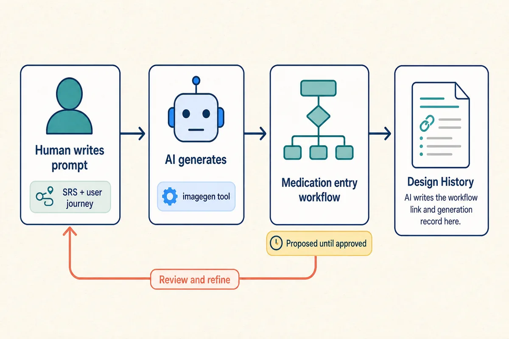
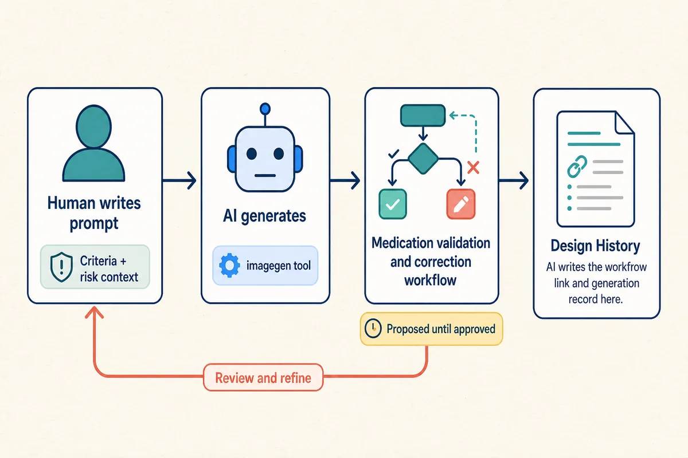
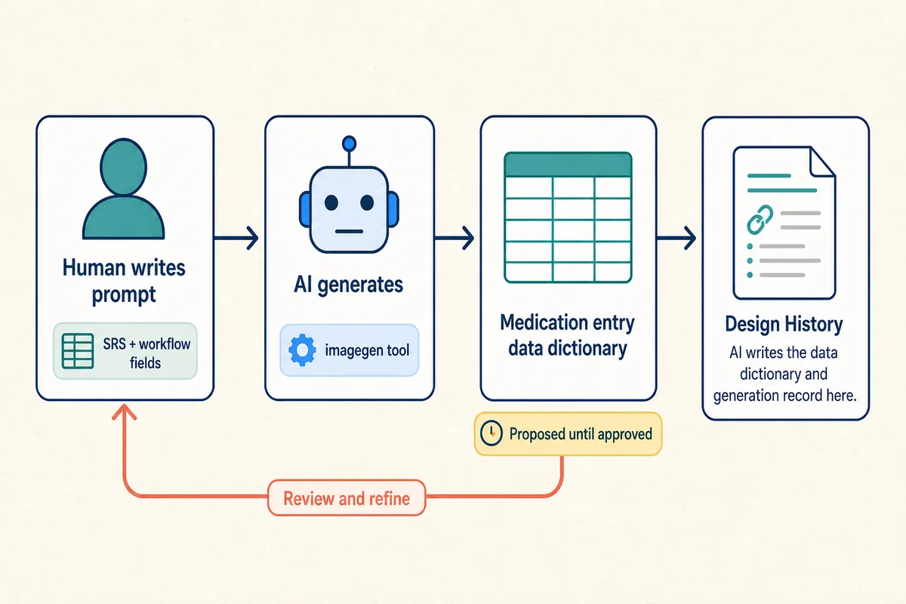

PLAYBOOK 03: AI-ASSISTED DESIGN

# 1. Purpose

This playbook builds on Playbook 02 and follows the approved URS, the [SRS item template](artifacts/srs-item-template.md), and the SRS item example.

Design translates one approved URS item into one development-ready SRS item. AI can help explore the need, draft precise software behaviour, expand acceptance criteria, model workflows, create design artifacts, and find gaps. People remain responsible for evidence, decisions, risk, approval, and the handoff to Development and Testing.

The worked SRS item concerns `URS-MED-014`: authorised clinicians must record medication given to a trial participant between pre-treatment and post-treatment assessments. The application records medication information and timing; it does not administer medication or analyse efficacy.

# 2. Design Activities

| Design activity | SRS template sections completed | Primary AI use |
| --- | --- | --- |
| Frame | **Title**; **Requirement**; **Rationale**; **Dependencies and Assumptions**; **Questions or Decisions** | A bounded `create-srs` skill generates the SRS item skeleton from one URS number and frames the design intent. |
| Specify | **Acceptance Criteria**; **Risks and Mitigations** | Iterative AI questioning expands the framed requirement into software behaviour and controls for material risks. |
| Model | **Design History** | AI helps explore workflows, data, interfaces, exceptions, decisions, and design artefacts. |
| Review | **Traceability and Verification** | Independent AI challenge helps compare evidence, complete verification links, and prepare approval. |

*AI can support each Design activity; human review remains the approval gate.*

The operating pattern uses the least capable approved setup for each task: a conversational model for supplied context, read-only search for evidence, bounded skills for repeatable SRS drafting and interrogation, repository tools for traceability, and `imagegen` for wireframes or workflow diagrams. AI suggestions remain proposals until a person verifies them.

# 3. Frame

Frame uses agentic AI to establish the scope and intent of one approved URS item before detailed behaviour is specified. A bounded `create-srs` skill can take a URS number, load the [SRS item template](artifacts/srs-item-template.md), create a working SRS item, and populate relevant sections with source-backed content. Context engineering limits the skill to the approved URS, labelled sources, and working output. Human review remains responsible for deciding whether the framing is supported and complete.

Use this prompt with the `create-srs` skill:

> Invoke the `create-srs` skill for the SRS item linked to `URS-MED-014`. Use the approved URS, SRS template, labelled sources, and supplied context. Create the SRS item skeleton and populate Title, Requirement, Rationale, Dependencies and Assumptions, and Questions or Decisions. Separate confirmed facts from interpretation, show proposed changes, and do not draft detailed Acceptance Criteria or implementation code.

*The `create-srs` skill can prepare a draft structure; a person decides whether the framing is supported and complete.*

The resulting draft gives Specify a source-backed framing of the design intent, priorities, dependencies, and unresolved questions. Human review compares the draft with the sources and carries forward only supported decisions.

# 4. Specify

This phase is focused on surfacing Acceptance Criteria, Risks, and Mitigations. These represent what will be coded and tested. This should be an iterative process and AI Skills can be utilised here to good effect. For example, a `grill-me` skill can start an iterative interrogation between the AI and user. Context engineering supplies the approved URS, framed assumptions, dependencies, and reference material as a bounded context pack. The skill asks one focused question at a time, while the model maintains traceability between each answer. Human answers and review keep the process grounded in the intended workflow and prevent AI from inventing policy or behaviour.

Use this prompt:

> Invoke the `grill-me` skill for the SRS item linked to `URS-MED-014` to surface clear Acceptance Criteria and identify Risks and Mitigations. Use the framed SRS Requirement, assumptions, dependencies, and reference material as context. Ask one question at a time to surface application behaviour and risks. After each answer, propose or revise the affected Acceptance Criteria and related Risk and Mitigation. Cover users, workflow, information, rules, boundaries, errors, access, correction history, and excluded behaviour. Keep criteria concise, observable, application-facing, and written with “shall”; tie each risk to a criterion. Separate facts, decisions, assumptions, and unanswered questions. Stop when no material gap remains and require human review before closing or accepting anything.

*The `grill-me` skill uses iterative questioning to connect the framed SRS to development- and test-ready outputs.*

The output is a working set of development-ready Acceptance Criteria and Risks and Mitigations, with unresolved questions retained for review. The SRS remains the source of truth; AI provides structured questioning, drafting, and traceability support.

# 5. Model

Model uses bounded SRS context, prescriptive prompts, skills, and tools to create implementation-facing design artefacts. Each output remains proposed until a person confirms that it is supported, consistent, traceable, and useful to Development.

### Medication capture wireframe

A person writes a prompt using the accepted SRS context. AI generates the medication capture wireframe and records it in Design History. The person reviews the result and refines the prompt until the wireframe is acceptable.

> Using the accepted context for the SRS item linked to `URS-{NNN}`, generate a low-fidelity medication capture wireframe showing participant and assessment context, medication and timing fields, validation guidance, and Save and Cancel actions. Use the `imagegen` tool and supplied labels. Exclude unsupported controls and final visual styling. Save the wireframe and add its link, prompt, sources, date, and status to Design History. Return the draft for human review and revise it when feedback is provided.

### Medication entry workflow

A person writes a prompt using the accepted SRS context. AI generates the medication entry workflow and records it in Design History. The person reviews the result and refines the prompt until the workflow is acceptable.

> Using the accepted context for the SRS item linked to `URS-{NNN}`, generate a medication entry workflow from test completion through screen display, context review, medication entry, submission, and confirmation. Use the `imagegen` tool and supplied labels. Show user actions and application responses and exclude exception behaviour. Save the workflow and add its link, prompt, sources, date, and status to Design History. Return the draft for human review and revise it when feedback is provided.

### Medication validation and correction workflow

A person writes a prompt using the accepted criteria, risks, and design decisions. AI generates the validation and correction workflow and records it in Design History. The person reviews the result and refines the prompt until the workflow is acceptable.

> Using the accepted context for the SRS item linked to `URS-{NNN}`, generate a medication validation and correction workflow covering authorisation, required-field and timing validation, correction before saving, save confirmation, and correction history after saving. Use the `imagegen` tool and supplied labels. Mark unsupported branches as unresolved. Save the workflow and add its link, prompt, sources, date, and status to Design History. Return the draft for human review and revise it when feedback is provided.

### Data dictionary

A person writes a prompt using the accepted SRS context and workflow fields. AI generates the data dictionary and records it in Design History. The person reviews the result and refines the prompt until the table is acceptable.

> Using the accepted context for the SRS item linked to `URS-{NNN}`, generate the Medication entry data dictionary with columns for Data item, Type or allowed values, Required, and Use in the workflow. Use only supplied evidence, mark unknown values as unresolved, and preserve names used by the workflows. Add the proposed table, prompt, sources, date, and status to Design History. Return the draft for human review and revise it when feedback is provided.

# 6. Review

Use a fresh context or independent reviewer to challenge the AI-assisted draft. Ask AI to compare the Requirement, Acceptance Criteria, workflows, data dictionary, wireframe, and sources for:

- unsupported scope or invented policy;
- ambiguous terms or missing states;
- wrong participant or assessment association;
- missing validation, authorisation, or correction behaviour;
- inconsistent field names or diagrams; and
- gaps in traceability or verification.

> Review this SRS item against its one related URS item and labelled source context. Identify unsupported behaviour, ambiguity, missing application states, access-control gaps, validation gaps, correction-history gaps, and discrepancies between the text and design artifacts. Return evidence and proposed questions. Do not close questions, accept risks, or approve the item.

Record each resolved question in Design History with the evidence considered, options, human decision, approver, affected criterion or artifact, and date. A closed question without design detail is not an adequate decision record.

Before handoff, a person confirms that the SRS item contains:

- one approved related URS item;
- a concise Requirement and Rationale;
- application-facing Acceptance Criteria ready for development and testing;
- risks and mitigations, dependencies, and assumptions;
- traceability and verification placeholders;
- closed Questions or Decisions with detailed Design History;
- linked wireframes, workflow diagrams, or data dictionaries; and
- enough evidence to explain material AI assistance.

Mark the item **Approved for development** only through the agreed human review authority. If implementation or testing reveals an unclear need, return it to Design or Planning rather than silently changing the requirement.

# 7. Summary

AI-assisted Design is disciplined translation. The team supplies a bounded context pack, prompts AI to draft one requirement, expands it into observable application behaviour, uses skills and tools to model the feature, challenges the result, and records the decisions that make it ready for development.

AI accelerates drafting, comparison, visualisation, and review preparation. People verify evidence, decide, approve, and remain accountable for the software behaviour.
