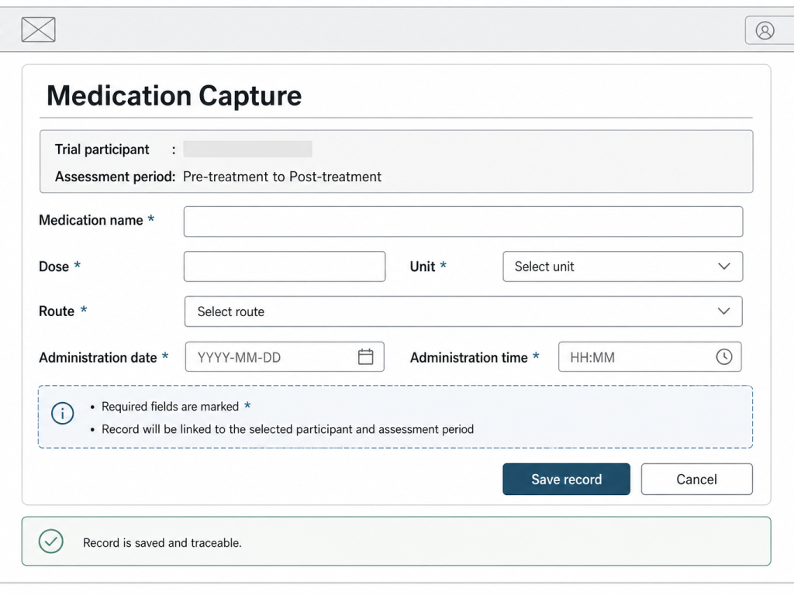
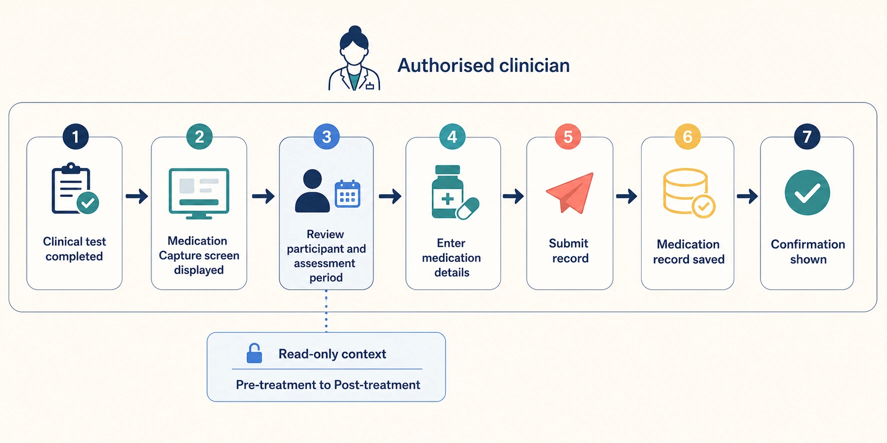
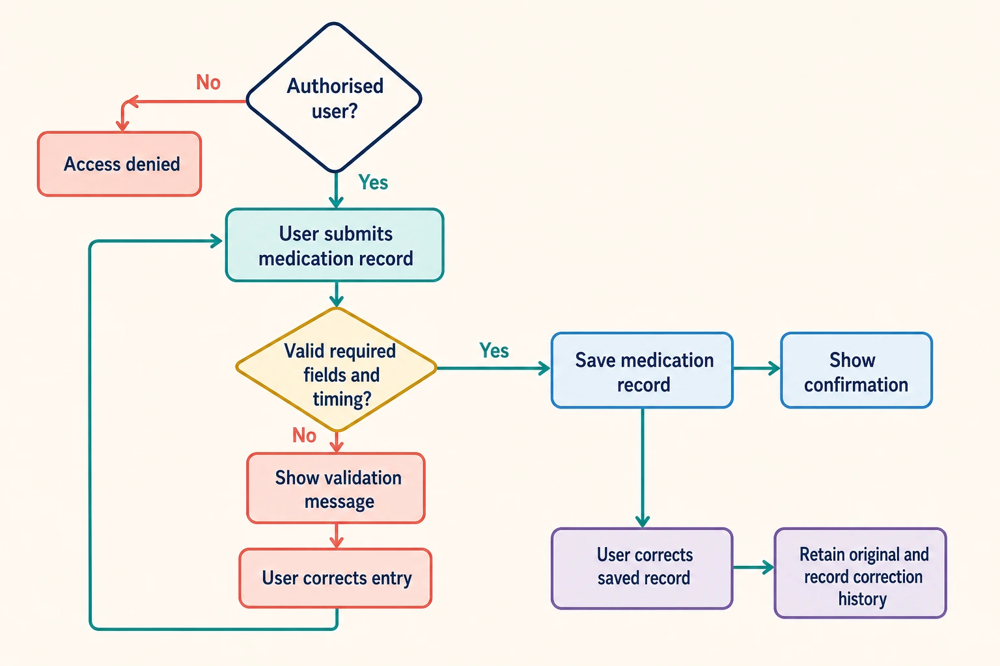

# SRS Item: Record Medication Details

**ID:** SRS-MED-CAPTURE-014  
**Status:** Approved for development  
**Priority:** Must  
**Related URS:** URS-MED-014

## Title

As an authorised clinician, I want to record medication administered between the pre-treatment and post-treatment tests, so that the efficacy of the medication can be analysed later.

## Requirement

The application shall provide an authorised clinician with a medication-recording workflow that captures the medication details required by the approved trial workflow and associates the record with the selected trial participant and assessment period.

## Rationale

This expands `URS-MED-014` from a planning need into a software capability that can be designed, built, and verified. The record supports approved downstream efficacy analysis outside the application. The application records the information but does not administer medication or determine efficacy.

## Acceptance Criteria

- After the authorised clinician completes the relevant clinical test, the medication capture screen shall be displayed with the selected trial participant and assessment period shown as read-only context.
- The medication capture screen shall provide fields for medication name, dose, approved dose unit, route, and administration date and time.
- When the clinician submits a complete and valid record within the approved timing window, the application shall save the record against the selected participant and assessment period and display a save confirmation.
- When a required field is missing, a value is invalid, or the administration time is outside the approved window, the application shall display a clear validation message and shall not save the record.
- When a user is not authorised to capture medication, the application shall prevent access to the medication capture screen and prevent record submission.
- When an authorised user corrects a saved medication record, the application shall retain the original value and record the correction, user, and date and time in the accountable history.

## Risks and Mitigations

| Risk | Mitigation |
| --- | --- |
| A medication record could be linked to the wrong participant or assessment period. | Require selection from the active clinical context and verify the association before saving. |
| An entry could be incomplete, invalid, or outside the approved timing window. | Apply required-field, value, and protocol-timing validation before saving. |
| Medication information could be accessed or changed by an unauthorised user. | Apply existing authorisation controls and retain an accountable change history. |
| Users could interpret the record as medication administration or an efficacy conclusion. | Keep administration and efficacy analysis outside the workflow and use clear record terminology. |

## Dependencies and Assumptions

- The approved trial protocol defines the assessment period and timing rules.
- Existing identity and authorisation controls can identify authorised clinicians.
- Existing clinical-test workflow and participant records provide the participant and assessment context.

## Traceability and Verification

| Design/component | Story or task | Test/evidence | Verification method |
| --- | --- | --- | --- |
| Medication-recording workflow and data model | <work item to be created> | <test evidence to be created> | Test valid, invalid, boundary, and unauthorised scenarios |
| Assessment-period association | <work item to be created> | <test evidence to be created> | Test participant and assessment linkage |
| Accountable change history | <work item to be created> | <test evidence to be created> | Inspect and test correction and audit behaviour |

## Questions or Decisions

| ID | Question or decision | Owner | Status |
| --- | --- | --- | --- |
| Q-MED-001 | What medication information must be recorded? | Clinical and sponsor owners | Closed |
| Q-MED-002 | What timing rules and exceptions apply? | Clinical and protocol owners | Closed |
| Q-MED-003 | How are late entries, duplicate records, and corrections handled? | Product, clinical, and quality owners | Closed |

## Design History

### Medication information to record

**Question:** What medication information must be recorded?  
**Date:** 2026-08-18  
**Participants/approver:** Clinical and sponsor owners

**Design detail:** The record needs enough information to identify what was given and relate it to the clinical context. The design therefore considered the medication name, dose, route, administration date and time, trial participant, and assessment period. These fields are required to support the approved downstream analysis and to prevent an otherwise ambiguous record.

**Decision:** Capture medication name, dose, route, administration date and time, trial participant, and assessment period. Use the approved units and route values from the trial workflow.

**Effect on development:** The medication-recording screen and data model must implement the participant and assessment context, medication fields, requiredness rules, and approved values. This expands the first and second Acceptance Criteria.

### Timing rules and exceptions

**Question:** What timing rules and exceptions apply?  
**Date:** 2026-08-18  
**Participants/approver:** Clinical and protocol owners

**Design detail:** The record is valid only within the assessment period defined by the approved trial protocol. The design considered allowing an entry outside the window with a warning, but that would permit a record that cannot be confidently used for the intended analysis. The workflow will therefore validate the entered administration date and time before saving.

**Decision:** Apply the approved protocol timing boundaries and reject entries outside those boundaries before saving. No exception is included in this SRS item until the protocol defines one.

**Effect on development:** Development must implement timing-boundary validation, an actionable validation message, and no-save behaviour for an out-of-window entry. This expands the fourth Acceptance Criterion.

### Late entries, duplicates, and corrections

**Question:** How are late entries, duplicate records, and corrections handled?  
**Date:** 2026-08-18  
**Participants/approver:** Product, clinical, and quality owners

**Design detail:** Silent replacement or deletion would make it impossible to distinguish the original record from a correction. The design will retain the saved record and record the correction as an accountable history event. Duplicate detection and late-entry handling will follow the approved workflow; this item does not introduce automatic merging or deletion.

**Decision:** Saved records and corrections require an accountable history. Late entries and duplicates are handled through the approved workflow and are not silently discarded or merged.

**Effect on development:** Development must retain the original record, record who made each correction and when, and expose the history to authorised reviewers. This expands the sixth Acceptance Criterion and the verification plan.

The acceptance criteria above are the development baseline for this SRS item. Any change to the fields, timing rules, authorisation behaviour, or change history requires review and update of this Design History.

### Medication capture wireframe

**Artifact:** `srs-example-mockup.png`  
**Date:** 2026-08-18  
**Purpose:** Show the application screen and interaction scope that the Acceptance Criteria describe.

The wireframe shows the read-only trial participant and assessment-period context, medication fields, timing fields, validation guidance, and Save/Cancel actions. It is a design aid for development and does not approve visual styling, final copy, or technical implementation.

### Design artifact: Medication entry workflow

**Artifact:** `srs-medication-workflow.webp`  
**Date:** 2026-08-18  
**Purpose:** Show the normal application workflow covered by the Acceptance Criteria.

The workflow shows how an authorised clinician reaches the medication capture screen, reviews the read-only participant and assessment context, enters medication details, submits the record, and receives confirmation.

### Design artifact: Medication validation and correction workflow

**Artifact:** `srs-medication-validation-workflow.webp`  
**Date:** 2026-08-18  
**Purpose:** Show validation, authorisation, save, and correction behaviour.

The workflow shows the authorised-user gate, required-field and timing validation, the correction loop before saving, and the accountable history retained when a saved record is corrected.

### Data dictionary: Medication entry

| Data item | Type or allowed values | Required | Use in the workflow |
| --- | --- | --- | --- |
| Trial participant | Existing participant identifier | Yes | Read-only context for the selected clinical workflow. |
| Assessment period | Pre-treatment to post-treatment context | Yes | Read-only context used to associate the record. |
| Medication name | Approved medication value or text format | Yes | Identifies the medication recorded. |
| Dose | Numeric value with approved unit | Yes | Records the medication amount. |
| Route | Approved route value | Yes | Records how the medication was administered. |
| Administration date and time | Valid date/time within the approved timing window | Yes | Establishes when the medication was administered. |
| Correction history | Original value, corrected value, user, and date/time | When corrected | Preserves an accountable history of changes. |
